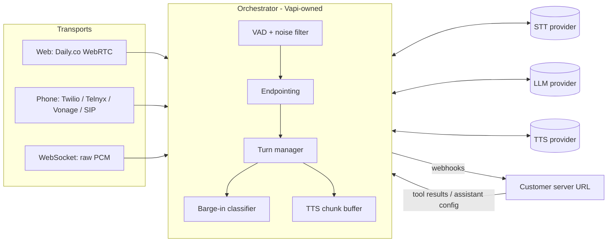

# Vapi: how it works

**Target:** Vapi's public, open-source repos (see `notes/sources.md`):

- `client-sdk-web`: browser SDK, MIT (per its `package.json`)
- `server-sdk-typescript`: generated API client, no license declared
- `docs`: public docs, MIT
- `client-sdk-python`: MIT

I used only static reading. Nothing was run, and no Vapi service was called.

Every claim is tagged **CONFIRMED** (seen in code or stated in docs) or **GUESS** (inferred). Paths are relative to `target/`:

- `web/` = `client-sdk-web/`
- `sdk/` = `server-sdk-typescript/src/api/`
- `docs/` = `docs/fern/`

## 1. What it is

Vapi is a hosted orchestration layer for voice agents. A customer configures an **assistant** with three parts:

- transcriber (speech-to-text)
- model (LLM)
- voice (text-to-speech)

Vapi runs the real-time loop between them over web, phone or WebSocket calls, and calls back to the customer's server for tools and events. **CONFIRMED** (`docs/security-and-privacy/data-flow.mdx:41-83`)

Vapi does not make the speech or language models itself. It brokers about 14 STT, 17 LLM and 20 TTS providers (`sdk/types/AssistantTranscriber.ts:9-22`, `AssistantModel.ts:9-25`, `AssistantVoice.ts:9-28`). **CONFIRMED**

What Vapi actually builds is the **orchestration** layer, which customers cannot replace (`docs/security-and-privacy/data-flow.mdx:116-128`). **CONFIRMED** It covers:

- endpointing
- interruption handling
- noise filtering
- backchanneling
- filler injection
- emotion detection

## 2. Entry points

| Entry | What it does | Citation |
|---|---|---|
| `POST https://api.vapi.ai/call/web` | Creates a web call and returns `webCallUrl` (a Daily.co room) plus an optional token | `web/vapi.ts:512-523, 548-559`; `web/api.ts:52997-53012` |
| `POST /call` | Creates a phone call (`phoneNumberId`, `customer`) or a WebSocket call (`transport.provider: "vapi.websocket"`) | `sdk/resources/calls/client/requests/CreateCallDto.ts:14-118` |
| `wss://api.vapi.ai/<callId>/transport` | Raw audio over WebSocket: binary PCM or mu-law plus JSON control frames | `docs/calls/websocket-transport.mdx:21-104` |
| SIP `sip.vapi.ai:5060/5061` | Phone calls via SIP trunks; RTP on UDP 40000-60000 | `docs/advanced/sip/sip-networking.mdx:26-93` |
| Customer "server URL" | Vapi POSTs `{message:{type,...}}` webhooks to the customer | `docs/server-url/events.mdx:8-31` |
| `call.monitor.listenUrl` / `controlUrl` | Listen to a live call; inject `say`, `add-message`, `end-call` or `transfer` | `docs/calls/call-features.mdx:12-76` |

All rows **CONFIRMED**.

## 3. Modules

**GUESS** on the internal boxes and their arrangement, assembled from the docs' description of the pipeline. Each stage the boxes name is **CONFIRMED** in the docs.

## 4. Data flows

### 4.1 Web call setup

1. The browser SDK sends `POST /call/web` with an `assistant` or `assistantId`, using a bearer token (`web/vapi.ts:512-523`). **CONFIRMED**
2. The response carries `webCallUrl`, a Daily room. The SDK creates a Daily call object and joins with `subscribeToTracksAutomatically: false` (`web/vapi.ts:577-581, 764-771`). **CONFIRMED**
3. It plays only audio from the participant named `"Vapi Speaker"` (`web/vapi.ts:1150`), then sends `"playable"` to the server (`:1196`). **CONFIRMED**
4. The server sends `"listening"`, and the SDK fires `call-start` (`web/vapi.ts:1032-1053`). **CONFIRMED**
5. Server-side, a bot joins the Daily room for the call. **GUESS**

### 4.2 One conversational turn

1. User audio passes through VAD and the transcriber (`docs/customization/voice-pipeline-configuration.mdx:111`). **CONFIRMED**
2. Endpointing decides when the user has finished speaking (`:120-125`). **CONFIRMED** It checks, in priority order:
   - the transcriber's own end-of-turn signal
   - `customEndpointingRules` (regex)
   - the smart-endpointing model (Vapi, LiveKit, Deepgram Flux, AssemblyAI or custom)
   - the heuristic fallback, `transcriptionEndpointingPlan`:
     - transcript ends in a number: wait 0.5 s
     - transcript ends in punctuation: wait 0.1 s
     - no punctuation: wait 1.5 s

     Source: `:322-335`, `sdk/types/TranscriptionEndpointingPlan.ts:14-30`.
3. The LLM request goes out immediately (`:127`). **CONFIRMED** Tokens stream into a TTS chunk buffer (`voice.chunkPlan`), and a `<flush />` tag forces a chunk out (`docs/assistants/flush-syntax.mdx:24-46`). **CONFIRMED**
4. TTS audio goes out after `waitSeconds` (default 0.4 s) (`voice-pipeline-configuration.mdx:458-483`). **CONFIRMED**
5. Streamed tokens are sent as `model-output` with a `turnId`, and transcripts as `transcript` (partial or final) (`web/api.ts:45850-45964`). **CONFIRMED**
6. TTS is called once per chunk, not once per turn. **GUESS**

Latency figures from the docs:

- Target voice-to-voice latency is under 500-700 ms (`docs/quickstart.mdx:51`). **CONFIRMED**
- The docs' own worked example totals 2.3 s (`voice-pipeline-configuration.mdx:478-507`). **CONFIRMED**

### 4.3 Barge-in (interruptions)

1. When the user speaks over the assistant, the system checks, in order (`voice-pipeline-configuration.mdx:133-146, 536-642`):
   - `interruptionPhrases`: stop immediately
   - `acknowledgementPhrases`: ignore ("uh-huh")
   - otherwise, the `numWords` threshold. `0` means pure VAD after `voiceSeconds`, about 50-100 ms; above 0 waits for transcribed words, about 200-500 ms.

   **CONFIRMED**
2. `backoffSeconds` (default 1) blocks new output after an interruption. **CONFIRMED**
3. The server emits `user-interrupted {turnId}`, so clients can drop that turn's output (`docs/server-url/events.mdx:423-434`). **CONFIRMED**
4. The web client does no barge-in or playback flushing itself; it only passes events through. **CONFIRMED** (absent from `web/vapi.ts`)
5. Because the client doesn't flush, the server must stop the audio in the room itself. **GUESS**

### 4.4 Tools and webhooks

1. Tools are OpenAI-style function definitions (`web/api.ts:5754-5772`). **CONFIRMED**
2. Vapi POSTs `tool-calls` to the server URL with a `toolCallList` (`web/api.ts:48117-48145`). **CONFIRMED**
3. The customer replies `{results:[{toolCallId, result}]}`. The default timeout is 20 s, and spoken messages cover start, delayed, complete and failed (`docs/tools/api-request/reliability.mdx:17,144-149`). **CONFIRMED**
4. Only four webhook types expect an answer: `assistant-request` (7.5 s budget), `tool-calls`, `transfer-destination-request` and `knowledge-base-request` (`docs/server-url/events.mdx:8-31, 123-129`). **CONFIRMED**
5. The other webhooks are notifications: `status-update`, `end-of-call-report`, `transcript`, `speech-update`, `conversation-update`, `hang` and others. **CONFIRMED**

### 4.5 Custom-provider contracts (Vapi's internal interfaces, as exposed to customers)

| Provider | Contract | Citation |
|---|---|---|
| **LLM** | OpenAI-compatible `/chat/completions` with SSE streaming | `docs/customization/custom-llm/using-your-server.mdx:75-102` |
| **STT** | WebSocket. A `{type:"start", encoding:"linear16", sampleRate:16000, channels:2}` frame, then stereo PCM (channel 0 = customer, 1 = assistant). You reply `transcriber-response` | `docs/customization/custom-transcriber.mdx:27-62` |
| **TTS** | Vapi POSTs `voice-request {text, sampleRate}`; you reply with chunked raw s16le mono PCM | `docs/customization/custom-tts.mdx:311-378` |

All rows **CONFIRMED**.

## 5. Anything weird

- **Workflows are being retired.** The node-graph "Workflows" product is due for retirement on 2026-08-18, in favour of Squads (multi-assistant handoffs) (`docs/workflows/legacy-migration.mdx`). **CONFIRMED** Their stated reason is that node graphs performed worse.
- **Schema drift between the two SDKs.** `silenceTimeoutSeconds` is absent from the current `Assistant` type but still documented. **CONFIRMED** `backchannelingEnabled` was removed from config but still appears in docs examples (`docs/changelog/2024-10-25.mdx:9`). **CONFIRMED**
- **Hand-patched type in the web SDK.** It suppresses a type error to read `webCallUrl`, which the generated `Call` type lacks (`web/vapi.ts:765`). **CONFIRMED**
- **Possibly AWS us-west-2.** The infrastructure hostnames point there (`docs/calls/call-features.mdx`). **GUESS**
- **No secrets.** No hardcoded secrets were found in the parts read.
