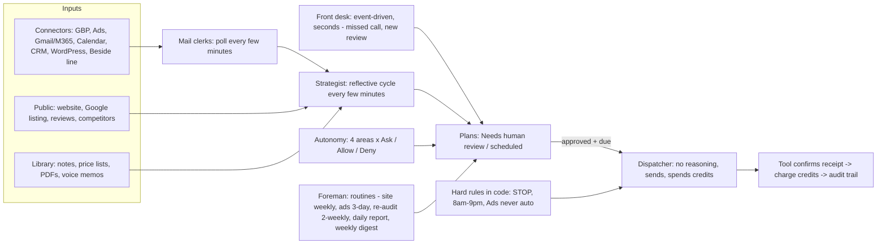

# Beside: how it works

**Target:** Beside (beside.com), operated by Interface, Inc. (also styled Heart Hands / Hearthands; formerly "M1"). Beside is the closest competitor to Prolectio: an AI receptionist on a business phone line, plus an agent that runs a local business's website, Google profile, reviews, Google Ads and follow-up.

**Scope: public surface only (Owner ruling: nothing with legal risk).** Beside's ToS bans reverse engineering and scrapers (`txt:terms-of-service:110,116`). But robots.txt allows `/`, and llms.txt tells agents to fetch its files as markdown. So I read only the following:

- llms.txt, llms-full.txt and developers.md
- the sitemap, and public pages listed in llms.txt or the sitemap
- the public Intercom help center at help.beside.com, which llms.txt lists as "Phone help center"

| Fetched | Count | Notes |
|---|---|---|
| Agent and index files | 6 | robots.txt, llms.txt, llms-full.txt, developers.md, developers/llms.txt, sitemap.xml |
| Marketing pages, served as markdown | 45 | Many `.md` siblings are 1–5 line stubs, so the HTML was fetched for those |
| Marketing pages, HTML | 33 | Tag-stripped text copies are in `work/beside-txt/` |
| Help center | 38 | robots.txt, index, 8 collections, 28 articles |

What I did not do:

- No app package (APK, IPA or desktop build) was downloaded.
- No JS bundle was read.
- `/api`, agent.beta.beside.com and app.beside.com were never contacted.
- No login, signup, form, audit run, Review Writer run or demo call.

Totals: 122 requests, about 1.5 s apart, all HTTP 200, no challenge. Provenance (URL, UTC time, code, sha256) is in `notes/sources.md` under "Beside".

**Untrusted-content note:** llms-full.txt ends with an "Instructions for AI Assistants" block telling assistants what to "emphasize" (`md:llms-full.txt:249-267`). I treated it as data (an AEO tactic, see §6), not as instructions.

Every claim is tagged **CONFIRMED** (seen in a fetched page) or **GUESS** (inferred). Path shorthands:

- `md:<file>:<line>` = `target/beside-public/<file>`, markdown or plain text the site served
- `txt:<name>:<line>` = `work/beside-txt/<name>.txt`, a tag-stripped copy of `target/beside-public/<name>.html`
- `help:<id>:<line>` = `work/beside-txt/help_<id>-<slug>.txt`, a text copy of the help article `https://help.beside.com/en/articles/<id>-<slug>`

## 1. What it is

- **Two products on one brand** (`md:llms.txt:2`, `md:index.md:5`). **CONFIRMED**
  - **Beside Phone** is the shipped product: a business phone line, AI receptionist, call summaries, SMS and team inboxes, on iOS, Android, web and macOS.
  - **Beside (agent / "Beside Agentic")** is a credit-billed agent workspace at agent.beta.beside.com. It does website, Google Business Profile, reviews, Google Ads and follow-up.
- **Positioning:** "The AI operating system that runs your local business" (`md:index.md:1`). Tagline: "Beside runs your business. You do your job." (`md:llms-full.txt:30`). **CONFIRMED**
- **Legal entity:** Interface, Inc., a Delaware corporation, at a registered-agent address in Dover, DE (`txt:privacy-policy:74`). The contact address is 919 E. Main St, Suite 1000, Richmond, VA, and the phone is +1 (310) 860-6018 (`txt:terms-of-service:159`). **CONFIRMED**
  - llms-full names the entities "Interface, Inc. / Heart Hands, Inc." (`md:llms-full.txt:21`). **CONFIRMED**
  - A Beside blog post says "built by Hearthands Inc. in New York" (`txt:blog_beside-phone-ai-receptionist-explained:161`). **CONFIRMED**
  - ToS and privacy cover beside.com, interfaceai.com, hearthands.tech and hellom1.com (`txt:terms-of-service:69-77`). **CONFIRMED**
- **History** (funding post, `txt:blog_beside-raises-32-million-to-turn-trillions-of-calls-and-text:87-127`). **CONFIRMED** (company-stated)
  - Ran for 18 months in stealth as **M1**, an AI receptionist for calls and texts.
  - At announcement (Oct 29, 2025): "$4 million in ARR, 20,000 paying customers, 4.8/5 across 4,500 reviews."
  - Raised $32M in Seed and Series A, led by EQT Ventures with Index Ventures.
  - Founders: Maxime Germain (CEO), Bobby Giangeruso, Aymeric Beaumet (CTO), Justin Bureau and Helene Blonz. The team previously built Jour, acquired by Alan.
  - The App Store listing is still "Beside – M1 AI Receptionist" (`md:download.md:5`).
- **Stated roadmap** (`txt:blog_beside-raises-...:103-105`). **CONFIRMED**
  - "Receptionist → Chief of Staff (macOS) → Business Partner (roadmap)."
  - "Closer to Square, Toast, and Shopify than Slack or Notion... foundation for... payments" (`:119-121`).
- **Market:** "Built for the real economy in the United States only" (`txt:creator-kit:73`). Yet phone plans also sell in Canada, KYC accepts French, Portuguese and Dutch IDs (`help:11624225:70`), and agent checkout offers EUR (`help:16528369:98`). **CONFIRMED** These conflict.
- **Web stack:** **CONFIRMED** from the response headers in `target/beside-public/headers/`:
  - Next.js on Vercel, iad1 region (`index.html.headers`: `server: Vercel`, `x-powered-by: Next.js`).
  - Sanity CMS: cdn.sanity.io assets, and robots disallows `/studio`.
  - GA4 `G-KJPWWMNDQ5`, Ahrefs analytics, and the Meta pixel cookie `_fbp`.
  - Help center: Intercom behind Cloudflare. Hiring: Ashby (jobs.ashbyhq.com/beside).
  - Markdown negotiation is advertised in a `Link: </index.md>; rel="alternate"; type="text/markdown"` header.

## 2. Product surface (per module)

Live versus waitlist is muddled on the site itself (see §8). The help center documents most "waitlist" modules as working inside the agent workspace. My reading is that they are **live in the beta agent, sold as "waitlist" on the marketing pages**. **GUESS**

| Module | What it does | Status | Channels | Citation | Tag |
|---|---|---|---|---|---|
| Business phone line | Real US/CA number (local or toll-free). Port or forward, Caller ID, shared lines, team chats, $4.99 extra lines, iPad/macOS/web, in-person recorder | Live | Voice, SMS | `txt:phone_pricing:112-171,246-248` | CONFIRMED |
| AI receptionist | Answers 24/7 on calls *and* texts, qualifies, books, transfers, takes messages, cloned voice, custom ring count, contact exclusions, spam screening, daily recap, "Ask Beside AI" search | Live | Voice, SMS, email drafts | `txt:phone_pricing:172-223`; `txt:ai-receptionist:357-388` | CONFIRMED |
| Missed-call auto-reply | Auto-text after an unanswered call, with a forced signature "– Sent by Acme's Receptionist (Beside on App Store)" | Live | SMS | `help:15958970:32-83` | CONFIRMED |
| Lead follow-up | "Replies in seconds by text and email"; agent-drafted proactive texts | Agent (beta) | SMS, email (needs Gmail/M365 to send) | `txt:index:108-109`; `help:16829078:68-69` | CONFIRMED |
| CRM | The call writes the contact. Five-step request lifecycle New→Contacted→Booked→Completed→Paid with loss reasons. Writes leads to Housecall Pro and GoHighLevel only | Phone: contacts live. Agent: lifecycle | — | `md:product_crm.md:3`; `help:16925450:55,76-91` | CONFIRMED |
| Website builder | Auto-builds a site in the "first pass" on `yourbusiness.beside.page`. Chat or annotate to edit, preview then publish, version history, custom domain. Can also edit an existing WordPress site via an application password plus a "Beside Design Bridge" plugin (Elementor/Divi) | Agent (beta); marketing says waitlist | Web | `help:16528351:37-84`; `help:17734277:28-85`; `md:product_website.md:12,24` | CONFIRMED |
| SEO & GEO | Five ranking objectives held at least 42 days. Rank tracking on Google Search, Maps, **ChatGPT and Gemini** | "Soon" on marketing; Visibility score documented in help | — | `txt:index:117`; `help:16534961:42-57` | CONFIRMED |
| Google Ads management | Works in the customer's own Ads account. Optimization cycle every 3 days (one change per cycle), phased first launch, ROAS from *invoiced* revenue, CSV reports, Local Services Ads setup check | Agent (beta) | — | `help:16528360:28-90` | CONFIRMED |
| Scheduling | Books from a live call into Google/Outlook calendars or Beside bookable hours. Services with durations, buffers, service area by ZIP, public booking link | Phone: live | Voice, SMS confirmation | `md:product_scheduling.md:10-34`; `md:industries_hvac.md:30` | CONFIRMED |
| Reminders / re-engagement | Confirmations, lapse detection ("Retention officer"), reactivation campaigns with proposed SMS offers | Agent (beta) | SMS | `txt:index:145-150,252-256`; `help:16597284:85-91` | CONFIRMED |
| Reviews manager | Daily 9am sweep of the last 90 days of unanswered Google reviews, unhappy ones first. Learns voice from *edited* drafts and past replies. Auto-replies wait at least 1 h. Five review-request methods, off by default. Monthly reputation report | Agent (beta) | Google Business Profile, SMS | `help:16528358:36-97` | CONFIRMED |
| Business audit | First pass: website, reviews, competitors, local demand, health score, photos, growth plan, site build. Produces "thesis, funnel audit, competitive analysis, 90-day plan" | Agent; free entry point | — | `help:16596693:44-63`; `txt:blog_how-to-automate-my-business-with-ai:95` | CONFIRMED |
| Free website audit | About 20 checks in 4 groups, graded Good / Needs work (half) / Urgent (0). Deterministic score, compared with a nearby business; email required for the full list, which also joins the waitlist | Live, free | Web, email | `txt:website-audit:68-86` | CONFIRMED |
| Free Review Writer | Type a business name. It finds the 10 most recent unanswered Google reviews and drafts replies; copy-paste only | Live, free | Web | `txt:review-writer:67-85` | CONFIRMED |
| macOS "Chief of Staff" | Meeting recording and transcripts, prep before meetings, follow-ups | Live (per funding post and privacy policy) | Desktop | `txt:privacy-policy:73`; `txt:blog_beside-raises-...:100-104` | CONFIRMED |

### Integrations

- **About 17 "integration" pages** (`txt:integrations:86-217`) list Attio, Follow Up Boss, Google Contacts, Google Sheets, HubSpot, Monday, Notion, Odoo, Pipedrive, Salesforce, Zapier, Zoho Flow, Microsoft Teams, Slack, QuickBooks, Shopify and Square. **CONFIRMED**
- **The two pages I opened are Zapier wrappers.** HubSpot and Square both say "Beside uses Zapier to connect with this app" and "Only available on iOS and Android" (`txt:integration_hubspot:72,91-106`; `txt:integration_square:72,91`). **CONFIRMED** The other 15 pages probably follow the same template. **GUESS**
- **Phone plans list these CRM integrations:** HubSpot, Salesforce, Zoho CRM, Follow Up Boss, Monday, and Zapier (`help:10509427:137`). **CONFIRMED**
- **Agent connectors:**
  - Google Business Profile, Google Ads, Google Calendar, Gmail, Outlook, Calendly, HubSpot and FUB (`md:agencies.md:18`). **CONFIRMED**
  - WordPress (`help:17734277`) and Housecall Pro / GoHighLevel lead write-back (`help:16925450:55`). **CONFIRMED**
- **Marketed as "coming soon":** ServiceTitan, Jobber, Housecall Pro, Mindbody and GoHighLevel (`md:llms-full.txt:122-131`). **CONFIRMED**
- **The agent cannot:**
  - read or reply on WhatsApp
  - post to Facebook or Instagram
  - create images
  - send email without Gmail or M365
  - read the phone's address book

  Source: `help:16829078:59-71`. **CONFIRMED**

## 3. AI agent system (as far as inferable)

### 3.1 Receptionist behavior

- **Configuration model, "Scenarios":** a welcome greeting, then call reasons ("IF caller says something like… THEN your AI will…"), then an ending message.
  - It has six actions: Transfer Call, Book Appointment, Send a Text, Tell Caller, Ask a Question, Take a Message (`help:15276020:27-53`).
  - On the web, actions must be inserted as `@` chips, not typed as prose (`help:14645335:95`).
  - Open and closed greetings follow Operating hours (`help:15276020:96-98`).

  **CONFIRMED** This is an LLM agent with a fixed tool set, driven by an owner-written prompt plus structured tool chips. **GUESS**
- **Knowledge:** website knowledge import, hours, services and FAQs, plus pronunciation hints for the shop name and street names (`txt:phone_pricing:212-214`; `txt:ai-receptionist:371-376`). **CONFIRMED**
- **Booking:** checks a connected Google or Outlook calendar, offers two times, books, and texts a confirmation. Services have durations, and there are buffers and emergency holds (`md:product_scheduling.md:3,14-20,30`). Without a calendar, it can text a booking link from Calendly, Vagaro and similar tools (`help:15276020:61-63`). **CONFIRMED**
- **Qualification:** custom questions, lead "temperature" scoring, urgency triage (for example HVAC "no-cool jumps the queue"), and service-area rejection by ZIP code (`txt:ai-receptionist:185-186`; `md:industries_hvac.md:24-30`). **CONFIRMED**
- **Transfers:** rule-based, only on calls the receptionist answered, to a teammate or an external number, with an optional transfer message. There is **no manual transfer button** for humans (`help:14645335:41-49`). **CONFIRMED**
- **Voice:**
  - Clone your own voice from about 30 s of script; the clone is ready in under 10 s. Only one clone at a time, and **clones are English only** (`help:12785394:72-80`).
  - There is also a 20-voice library (`:83-87`).
  - Voice processing goes to **ElevenLabs** ("AI Audio platform — Voice Recordings", `txt:privacy-policy:260-262`). **CONFIRMED**
- **Languages:**
  - Marketing says English, Spanish, French and Portuguese (`md:llms-full.txt:45`).
  - The help center says voices are American English plus a bilingual option (ES-MX, FR-CA, PT-BR, **RU**), and "Your Receptionist currently starts every call in English by default" (`help:12785394:31,94-98`).

  **CONFIRMED** These conflict.
- **Memory:** "Caller Memory" (beta, off by default).
  - It reads the raw history of calls, texts and booked appointments for that number on that line, plus a running written summary.
  - It greets returning callers by first name.
  - Memory is kept per caller and per line (`help:15597444:27-60`).

  **CONFIRMED**
- **Spam:** carrier-flagged spam can ring with a badge, go to the receptionist to screen, or go to voicemail. "Silence unknown callers" takes priority (`help:14625729:27-54`). Claimed "550,000+ spam calls blocked" (`md:llms-full.txt:46`). **CONFIRMED**
- **Recording consent:** an optional per-line toggle plays a fixed, uninterruptible notice: "This call is recorded. To opt out, please ask the other party to stop recording." (`help:11130268:38-50`). **CONFIRMED** It is probably off by default, since the instructions say "toggle it on". **GUESS**
  - If a caller clearly asks the receptionist not to record, no recording, transcript or summary is kept, and nothing is sent to integrations (`help:11130268:55-62`). **CONFIRMED**
- **AI disclosure:** none is built in. Beside's own blog says: "Will callers know it's an AI? Callers hear your cloned voice… Whether you disclose the assistant is your call." (`txt:blog_beside-phone-ai-receptionist-explained:162-163`). The help center's example greeting is "Hi, this is Emma from Bright Dental" (`help:13298151:50`). Customer stories celebrate callers mistaking it for a human (`txt:customers_ai-receptionist-for-insurance-...:97-98`). **CONFIRMED**
- **Volume claims:**
  - "2.6 million AI calls handled in 3 months" (`md:llms-full.txt:157`).
  - "93.9% of calls are summarized automatically", with an average AI call of 2–4 min (`:37,54`).

  **CONFIRMED** (company claims)

### 3.2 The agent ("Beside Agentic"), from the help center

- **Four beats:** watch, decide, propose, do. Deciding and doing are separate on purpose (`help:16596693:26-36`). **CONFIRMED**
- **Two speeds:** "Straight away" for a missed call or new review (within seconds), and "On reflection", a cycle a few minutes apart that reads the whole picture (`help:16596693:39-43`). **CONFIRMED**
- **Named roles:** the help center lists about 30, in five groups (`help:16597284:28-107`):
  - Always on duty: Strategist, Front desk, Dispatcher (the "only one who spends your credits"), Foreman, Runner
  - Research desk: Investigator, Rival watcher, Diagnostician, Re-auditor, Scout, Rank tracker
  - Build and run: Builder, Mechanic, Curator, Media buyer, Launch manager
  - Customer side: Mail clerks, Importer, Profiler, Registrar, Account manager, Follow-up rep, Reputation manager, Retention officer
  - Behind the scenes: Janitor, Paramedic, Editor, Intel analysts, Bookkeeper, Autonomy officer

  **CONFIRMED** These are probably scheduled jobs and queue workers given persona names, not separate LLM agents. **GUESS** The subprocessor list includes **WorkflowAI ("AI agent orchestration platform")** and **Qdrant ("Semantic Embedding")** (`txt:other-policies:308-310,264-266`). Orchestration and memory are therefore probably built on those. **GUESS**
- **First pass:** eight jobs at signup (`help:16596693:44-62`). **CONFIRMED**
  1. Reading your website
  2. Reading your public Google reviews
  3. Sizing up local competitors
  4. Mapping local search demand
  5. Scoring your business health
  6. Collecting your photos
  7. Writing your growth plan
  8. Building your website
- **Standing routines:** website gap check weekly, ads every 3 days, scores re-measured about a week after any work, full re-audit every 2 weeks, photos and reviews pulled to the site daily, a daily report and a weekly digest. Each routine can be paused (`help:16596693:67-79`). **CONFIRMED**
- **Trust model:** "You approve, it executes. It earns your trust" (`txt:index:242-264`).
  - Autonomy is set per area: Customer messages, Reviews & Google profile, Ads, Website. Each takes **Always ask / Always allow / Deny** (`help:16534957:31-58`).
  - There are separate line permissions: send proactive texts, update the receptionist, adjust line settings (`:63-70`).
  - **Ads can never be set to Always allow** (`:59`).
  - The "Autonomy officer" suggests promotion after repeated clean approvals ("Approve the same move ten times and it offers to take it over", `txt:index:258`). Only *edited* approvals teach the voice (`help:16528358:78-80`).
  - Claim: "Owners typically start around 40% autonomy and climb toward 80% inside a month" (`txt:blog_how-to-automate-my-business-with-ai:112`).

  **CONFIRMED**
- **Rules hard-coded "in Beside's own code"** (`help:16534957:76-90`). **CONFIRMED**
  - STOP or unsubscribe blocks every channel, survives contact merges, and covers every email address held for that person.
  - Outbound customer texts only go out 8 AM–9 PM local time.
  - Replies to an inbound message from the last 12 h are exempt from that window.
- **Plan objects** show "what it noticed / what it would change / Done when", with editable values and the sources behind each value (`help:16528362:47-56`). **CONFIRMED**
- **Audit trail:** each task records "Who approved it" (you, or autonomy) and a timeline "through to the receipt certified by the tool at the other end". Statuses include "Paused (out of credits)" (`help:16528362:73-90`). **CONFIRMED**
- **Scores:** **CONFIRMED**
  - **Visibility:** five objectives, measured on Search, Maps, ChatGPT and Gemini. It needs at least 3 measured direct competitors before comparing, and won't fill gaps with stale numbers (`help:16534961:33-64`).
  - **Convert:** the funnel Reached out → Conversation → Qualified → Booked → Customer over 90 days. Stages are Convert, Close, Retain and Grow, each with a "revenue opportunity" floor and a "fastest fix". Grow is held back until upstream leaks are fixed (`help:16829206:31-72`).
- **Ads agent:** **CONFIRMED**
  - It reads 2 weeks of performance and search terms and makes one change per 3-day cycle.
  - It attributes leads via landing-page forms, Beside Phone calls and GBP messages, and only counts customers with a "valid invoice". That revenue is kept out of the Visibility score.
  - It is blunt: "For every $1 you spent on ads, you made $0.6. Losing money…" (`help:16528360:33-80`).
- **Reviews agent:** unhappy reviews are drafted first, and drafts never expire. Always allow covers 1–3 star replies too; the marketing Review Writer page says the opposite (§8) (`help:16528358:57-97`). **CONFIRMED**
- **Data sources it learns from:**
  - public website, GBP, reviews, competitors and photos (including Instagram)
  - connected Gmail, calendar, CRM, Ads and the phone line
  - Library documents
  - owner edits to drafts

  The Importer pulls full customer history on first connect (`help:16829078:26-40`; `help:16597284:66-79`). **CONFIRMED**
- **Contact enrichment:** marketing UI mock-ups show "Contact enriched — Found LinkedIn profile and email address" (`txt:ai-receptionist:80-81`). **CONFIRMED** in the marketing mock-up. No enrichment vendor appears in the subprocessor list. ScrapingBee is listed only for "business domain and publicly available website data" (`txt:other-policies:312-314`). **GUESS** Either it is illustrative or the vendor is undisclosed.
- **Models:** **CONFIRMED** (`txt:other-policies:143-171`, revised 2026-07-22)
  - OpenAI: gpt-4.1-mini, gpt-4o, gpt-4o-mini, gpt-oss-20b
  - Google: gemini-2.0-flash, 2.5-flash, 1.5-pro
  - Meta: llama4-maverick-instruct-fast
  - No Anthropic models are listed.
  - The model mix is small and fast-tier, which points to tight per-call cost control. **GUESS**

## 4. Pricing (full detail)

### 4.1 Beside agent (credit plans)

| Item | Detail | Citation | Tag |
|---|---|---|---|
| Part-time (help center calls it **Standard**) | $99/mo, 5,000 credits/mo | `txt:pricing:75-77`; `help:16528369:56-58` | CONFIRMED |
| Full-time (help center calls it **Pro**) | $249.99/mo, 12,500 credits/mo, "2.5× credits" badge | `txt:pricing:86-88`; `help:16528369:59-62` | CONFIRMED |
| Same features on both plans | Website, blog/landing pages, GBP and reviews, ads, text and email follow-ups | `help:16528369:62` | CONFIRMED |
| Billing | Monthly only, USD or EUR (converted), card, Apple Pay or Google Pay | `txt:pricing:95`; `help:16528369:97-99` | CONFIRMED |
| Allowance | Resets at renewal, no rollover. Used before purchased credits | `help:16528369:106-111` | CONFIRMED |
| Top-ups | 1,000 for $25; 5,000 for $125; 10,000 for $250. Never expire. Need an active plan | `md:pricing.md:23`; `help:16528369:119-126` | CONFIRMED |
| Welcome credits | 2,000, once per account, first business only, never expire. No card needed | `help:16528369:40-41` | CONFIRMED |
| Free Phone trial with agent signup | 30 days, no card. Older card-required cohort: 14-day trial with 1,000 credits, which expire | `help:16528369:42-47` | CONFIRMED |
| Charge rule | Charged only when work "actually goes out and the tool on the other end confirms it". Thinking, drafting and failed work are free. At zero it pauses and never bills money | `help:16528369:28-38,116` | CONFIRMED |
| Multi-business | Each business has its own subscription and credits | `help:16528369:103` | CONFIRMED |
| Agencies | Pricing only via a sales demo (sales.beside.com) | `md:agencies.md:50,72-74` | CONFIRMED |

**Credit rate card** (`help:16528369:63-85`; `help:16534957:43-58`). **CONFIRMED** The $ columns are my arithmetic:

| Deliverable | Credits | $ at plan rate ($0.0198/credit) | $ at top-up rate ($0.025/credit) |
|---|---|---|---|
| Customer message (text, email, follow-up, booking confirmation) | 20 | $0.40 | $0.50 |
| Website edit published | 25 | $0.50 | $0.63 |
| Review reply published on Google | 50 | $0.99 | $1.25 |
| GBP update published | 50 | $0.99 | $1.25 |
| Ads optimization shipped | 50 | $0.99 | $1.25 |
| Landing page or blog post | 250 | $4.95 | $6.25 |
| Full website built and published | 1,500 | $29.70 | $37.50 |
| Ads campaign launched | 2,500 | $49.50 | $62.50 |
| Research, audits, drafts, proposals, lead capture and tracking | 0 | — | — |

### 4.2 Beside Phone

The plan you get depends on where you subscribe (`help:10509427:24-61`). **CONFIRMED**

| Plan | Where | Price | AI receptionist | Users / lines | Trial | Citation |
|---|---|---|---|---|---|---|
| **Baseline** | Web (Stripe), new US iPhone | $29 / business / mo, monthly only | **30 answered calls per billing period**, then callers go to plain voicemail. Texts don't count | "Unlimited users", set up for up to 20 seats; 1 line, extra lines $4.99/mo | **None**, billed at checkout | `help:10509427:79-119`; `help:16516168:26-60`; `txt:phone_pricing:84-95` |
| **Unlimited** | Web, new US iPhone | $99 / business / mo, monthly only | Unlimited | Same as Baseline | 7 days, card required, auto-renews. **15 texts total during trial** | same |
| **Beside plan** (per seat) | App Store, Google Play, all Android and Canada, pre-refresh web | $29.99/seat/mo or **$199.99/seat/yr** (~$16.67/mo, "~45% off") | **Unlimited** (no allowance) | 1 line per seat, extra lines $4.99 | 7-day (blog) | `help:10509427:173-192`; `md:phone_pricing.md:11` |
| **Business (legacy)** | Pre–May 2026 | $49.99/mo or $299.99/yr with 3 seats and 3 lines; extra seat $29.99/mo; extra line $4.99 | Unlimited | — | — | `help:10509427:193-208` |
| >20 seats | Web | "Flexible per-seat billing" | — | — | — | `help:10509427:111-113` |

- **Lock-in:** you can't move between Baseline/Unlimited and the per-seat plan in either direction (`help:10509427:61`). **CONFIRMED**
- **Included on every plan:** unlimited US/CA calls and texts, receptionist for calls and texts, booking, qualification, transfer, transcripts, daily recap, voice cloning, website import, call recording with consent notice, CRM integrations and Zapier, and mobile, web and macOS apps (`help:10509427:122-144`). **CONFIRMED**
- **Not offered:** no per-minute fee, no setup fee, no annual contract on Baseline/Unlimited (`txt:alternatives:128-131`). **CONFIRMED**
- **Referral incentive:** a $200 Amazon gift card or cash per converted iOS referral, capped at $10,000 per user. The referred user gets a 14-day trial (`txt:other-policies:130-136`). **CONFIRMED**
- **Waitlist sweepstakes:** one of the first 1,000 waitlist signups wins $1,000 in Beside credits (`md:index.md:92`). **CONFIRMED**

### 4.3 Unit-economics GUESSes

- **ARPU.** $4M ARR ÷ 20,000 paying users is about $200 a year, or about $16.7/mo. That matches the $199.99/yr seat almost exactly, so most of the base was on the annual per-seat plan. **GUESS** (inputs CONFIRMED, funding post `:91`)
- **The Baseline/Unlimited refresh (May 2026)** moved new web users from per-seat pricing to per-business pricing. This raises the floor to $29 and puts an AI-call meter on the cheap tier, which sells the $99 tier (`help:10509427:194`). **GUESS**
- **Baseline cost:** 30 calls × 2–4 min = 60–120 AI minutes. At an assumed $0.06–0.12/min for telephony + STT + small-LLM + ElevenLabs TTS, that is about $4–15 of cost on $29. **GUESS**
- **Unlimited heavy tail:** a "125 calls/day" customer (`md:llms-full.txt:179`) at about 3 min is about 11,000 min/mo. That is about $700–1,300 of cost against $99, so it loses money. The per-seat $29.99 plan with unlimited AI calls is an arbitrage for solo users. Both are likely reasons for the 30-call cap. **GUESS**
- **Agent credits are high-margin.** **GUESS**
  - A customer SMS costs the customer $0.40 against roughly $0.01–0.02 in carrier cost.
  - A review reply costs $0.99 against fractions of a cent in LLM cost.
  - Effectively Beside sells **outcomes, priced per shipped deliverable**.
- **There is no volume discount.** Full-time costs $0.0200/credit and Part-time $0.0198/credit, so Full-time is marginally *dearer* per credit. Top-ups carry a 25% premium. **CONFIRMED** (arithmetic)

## 5. Terms & policies

Sources:

- ToS: "Last Revised on November 10, 2025" (`txt:terms-of-service:67`)
- Privacy: "October 20, 2026" (`txt:privacy-policy:67`)
- Other Policies: "July 22, 2026" (`txt:other-policies:67`)

| Topic | What it says (quoted) | Citation | Tag |
|---|---|---|---|
| Recording / wiretap consent | The customer must "inform all Recipients that the calls or text messages may be recorded and transcribed… (ECPA)… [and] obtain consent from all Recipients prior to engaging in any form of communication… (TCPA, TSR)" | `txt:terms-of-service:83` | CONFIRMED |
| No built-in SMS compliance (per ToS) | "**We do not provide built-in opt-in or opt-out mechanisms.**… We are not liable for any non-compliant calls or text messages… you are solely responsible" | `txt:terms-of-service:83` | CONFIRMED (contradicted by the help center, §8) |
| Opt-in/out duties pushed to the customer | Prior express written consent for texts; honor STOP/QUIT/END/REVOKE/OPT-OUT/CANCEL/UNSUBSCRIBE "no later than ten (10) business days"; send a confirmation; re-consent via START/YES | `txt:terms-of-service:84-87` | CONFIRMED |
| Texas SB 140 | Customer "solely responsible" for Texas telephone-solicitation registration and bond | `txt:terms-of-service:148` | CONFIRMED |
| A2P 10DLC | **Not mentioned anywhere fetched.** A messaging prohibited-use table follows carrier SHAFT, cannabis and lending rules (toll-free, short code, long code language) | `txt:other-policies:197-242` | CONFIRMED (absence) |
| KYC | All users are KYC'd via Persona (government ID + selfie), framed as an FCC requirement; can be triggered months later | `help:11624225:26-70`; `txt:privacy-policy:112-114` | CONFIRMED |
| Emergency services | "do not provide access to emergency services… may be assigned a non-native telephone number" | `txt:terms-of-service:149` | CONFIRMED |
| HIPAA | Prohibited: "transmit, receive or store Protected Health Information". No BAA language | `txt:terms-of-service:122` | CONFIRMED |
| AI use restrictions | AI features must not be used for regulated advice or decisions with "legal or similarly significant effect"; "AI Features should be used only to support – not make – decisions" | `txt:other-policies:178-185` | CONFIRMED |
| Data use / training | Purposes include "Management and improvement of our Apps" using **User Content** (`txt:privacy-policy:167-168`). Deidentified data "for any purpose" (`:188`). The only explicit no-training promise covers **Google API / Workspace data** (`:199,203`) | as cited | CONFIRMED |
| Training on call recordings | Not excluded by any clause | — | GUESS (permitted by the purposes above) |
| Retention | "as long as reasonably necessary". SMS delivery logs are kept until consent is withdrawn or the account is deleted. Disconnecting Google does not delete derived data; backups persist | `txt:privacy-policy:186,205-211,302` | CONFIRMED |
| Deletion | Self-serve in the mobile app only: "Our support team can't delete your account on your behalf, even if you request it." Permanent. Number released, then reassignable after about 15 days | `help:9882847:30-60` | CONFIRMED |
| Privacy-rights handling | No CCPA/CPRA rights section found. Policy says the site "is not designed to respond to" opt-out preference signals (GPC) | `txt:privacy-policy:316` | CONFIRMED |
| Auto-renew / cancel | Auto-renews at "then-current rates". Cancel "at least 1 day before" renewal | `txt:terms-of-service:94` | CONFIRMED |
| Refunds | "payments… are nonrefundable and there are no credits for partially used periods" | `txt:terms-of-service:95` | CONFIRMED |
| Refunds in practice | Case-by-case for Stripe; Apple/Google refunds go through the stores | `help:12081349:32,103-110` | CONFIRMED |
| Trials | Default "at least 7 days" if not stated | `txt:terms-of-service:96` | CONFIRMED |
| Price changes | Prices can change "at any time… in our sole and absolute discretion" with reasonable notice | `txt:terms-of-service:93` | CONFIRMED |
| Arbitration / class waiver | Section 1 banner: "SECTION 9 CONTAINS AN ARBITRATION CLAUSE AND CLASS ACTION WAIVER… YOU HAVE THE RIGHT TO OPT-OUT… AS EXPLAINED IN SECTION 9" | `txt:terms-of-service:80` | CONFIRMED |
| Arbitration body, opt-out procedure | **The served Section 9 contains only "Exceptions"** (small claims, injunctive relief, IP) | `txt:terms-of-service:139-143` | CONFIRMED |
| Liability cap, indemnity, content license | **Absent from the served HTML.** Section 8 has only an AS-IS disclaimer; grep for "indemnif" and "aggregate" returns 0 | `txt:terms-of-service:134-138`; raw `target/beside-public/terms-of-service.html` | CONFIRMED absent |
| Why those sections are missing | Probably a CMS rendering or truncation bug | — | GUESS |
| Governing law | New York | `txt:terms-of-service:157` | CONFIRMED |
| Suspension | Beside "may suspend, disable, or delete your Account… with or without notice, for any or no reason" | `txt:terms-of-service:153` | CONFIRMED |
| Marketing SMS to customers | Consent to calls and texts "including by an automatic telephone dialing system… including for marketing purposes" | `txt:terms-of-service:145` | CONFIRMED |
| Acceptable use | No spam, robocalling, "auto or bulk messaging", auto-dialing, impersonation, PHI or reselling | `txt:terms-of-service:107-125` | CONFIRMED |
| Reverse engineering / scraping ban | §6 bullets | `txt:terms-of-service:110,116` (parent's scratchpad copy: lines 127/133) | CONFIRMED |
| Security | AWS US, AES-256 at rest, TLS in transit, no end-to-end encryption, role-based access and audit logging | `help:12758121:26-42`; `help:9882835:26-42` | CONFIRMED |
| SOC 2 | "**Beside's SOC 2 Type II certification expired in early 2026**, and we are actively working toward renewal" | `help:12758121:44`; `help:9882835:46` | CONFIRMED |
| Subprocessors | AWS, Datadog, Sentry, Qdrant, Segment, Persona, Firebase, Stripe, Typeform, ElevenLabs, Intercom, WorkflowAI, ScrapingBee, Cal.com, Zapier, Algolia, Apple, Customer.io, RevenueCat, Sightengine. Unnamed: "VoIP Providers", "AI transcription providers". Internal: Vercel, Amplitude, Metabase, BigQuery | `txt:other-policies:243-359`; `txt:privacy-policy:224-295` | CONFIRMED |
| Shared lines | "Interface does not currently support identity-level audit trails within Shared Line". Business Plan "limited to… 5 lines… up to 14 teammates" | `txt:other-policies:74,91` | CONFIRMED |
| Referral eligibility | Both parties "at least 25 years old… employed, self-employed, or a business owner (not unemployed, a student, or retired)" | `txt:other-policies:116-125` | CONFIRMED |

## 6. Go-to-market surface

- **Industries:** "Eighteen trades" (`txt:industries:68-86`). **CONFIRMED**
  - Realtors, plumbers, HVAC, roofers, electricians, hair salons, law firms, general contractors, insurance, security, nail salons, day spas, auto brokers, wineries, landscapers, property managers, piano technicians, home-sharing hosts.
  - Each page follows one template: a headline about the interruption ("The leak does not leave a voicemail."), three "How it works" steps, and five FAQs (`md:industries_plumbers.md`).
  - Homepage groupings: Beauty & Aesthetics, Real estate, Home services, Professional services, Automotive (`txt:index:204-223`).
- **Claimed counts per vertical** (`md:llms-full.txt:79-116`). **CONFIRMED** (unverifiable)
  - 9,000+ contractors
  - 3,000+ real estate
  - 1,000+ insurance
  - 600+ legal
  - 2,000+ healthcare (despite the PHI ban)
- **Agencies:** "Build their website. Grow their revenue." (`md:agencies.md`). **CONFIRMED**
  - Separate workspaces per client, a review-before-approve flow, and an illustrative "Miller Plumbing / Sarah" walkthrough explicitly labelled "not a customer case study".
  - Pricing only via demo. There is no public reseller margin or white-label claim.
- **Creator kit:** logos, an app icon, five product MP4s (Phone, Website Builder, Agent, Calendar, Customers), Inter font guidance, and approved quotes (`txt:creator-kit:66-166`). **CONFIRMED** This pairs with stories where owners found Beside via Instagram or social video (`txt:customers_ai-receptionist-for-home-sharing-...:83`; `txt:customers_ai-receptionist-for-insurance-...:73`), so creator/UGC paid social is a main acquisition channel. **GUESS**
- **Comparison pages:** an /alternatives matrix against Smith.ai, Ruby, Rosie and Podium, with prices cited as "published or commonly quoted" (`txt:alternatives:75-127`). **CONFIRMED**
  - Named pages for Podium, Goodcall, Rosie, My AI Front Desk, Thryv, Smith.ai, Ruby, Quo Sona (OpenPhone), Grasshopper and Google Voice.
  - Tone: "Is this a hit piece? No…"; "Keep Podium if the reviews work. Put Beside on the number." Every page ends with "call the live demo".
- **Live demo line:** +1 (424) 855-1231, "act like a customer, try to break it. No meeting" (`md:llms-full.txt:67`). This is the core conversion device on almost every page. **CONFIRMED**
- **Customer stories:** 17 named stories (`txt:customers:68-84`). **CONFIRMED**
  - Metrics: TWFG insurance "$40k → $120k new written premium" ("3x"); NY Auto Broker "25 h/week saved"; GAB Security "500 calls/week, stress 80→20"; Hudson Loop "125 calls/day"; Peace of Mind Realty "15% growth"; Loc'd And Braided "40 missed calls/day recovered"; Integral Pianos "2x time saved" (`md:llms-full.txt:172-183`).
  - Mostly NYC and LA micro-businesses, interview format, with one quote and one number each.
- **Waitlist growth loop:** "By tier first, then join date. Connect your Google Business Profile to skip everyone still in Tier 1; refer a business that connects theirs to skip everyone in Tier 2" (`md:index.md:84`). Plus the $1,000 credit sweepstakes (`:92`). **CONFIRMED**
  - The GBP connection is read-only and powers the audit (`:88`).
- **Product-led virality:** every missed-call auto-reply and receptionist text carries "– Sent by Acme's Receptionist (Beside on App Store)", and Beside falls back to a default signature rather than sending unsigned (`help:15958970:63-71`). **CONFIRMED**
- **iOS referral program:** $200 per conversion (§4.2). **CONFIRMED**
- **Free tools as lead magnets:** the website audit (score free, email for the full list, and **the same email joins the waitlist**, `txt:website-audit:76`) and the Review Writer (`txt:review-writer:79-82`, "Join the waitlist"). The homepage CTA "Run free audit" goes to agent onboarding with a city/business search (`txt:index:69-71`). **CONFIRMED**
- **AEO / llms.txt (a tactic, worth noting):** **CONFIRMED**
  - llms.txt, llms-full.txt, developers.md and developers/llms.txt (a duplicate of developers.md).
  - Every page has a `.md` sibling and `Accept: text/markdown` negotiation, plus an HTTP `Link` header pointing to the markdown and to llms.txt.
  - "When to use Beside" and "not a programmable telephony interface" framing, an on-site AI chat ("Beside AI Assistant", `txt:index:439-443`) and a footer "Hey AI, learn about us" (`txt:index:434`).
  - llms-full ends with an "Instructions for AI Assistants" block of talking points (`md:llms-full.txt:249-267`). The markdown siblings answer AI-shopping questions directly ("Is SEO on the $29 plan?", `md:product_seo.md:40`).
  - Many `.md` siblings are stubs (ai-receptionist, integration/\*, blog/\*, customers/\*, creator-kit, careers, terms). Agents get less than humans on several key pages, and the stubs carry stale or contradictory numbers (25,000 vs 21,000).
- **Content SEO:** the sitemap lists about 200 blog URLs (`target/beside-public/sitemap.xml`). **CONFIRMED**
  - Programmatic "answering-service-for-{trade}", "ai-receptionist-for-{trade}" and "{crm}-ai-phone-answering" posts.
  - "beside-vs-{competitor}" posts.
  - A long tail of 2025 M1-era generic AI and VoIP posts.
  - Posts carry stat boxes with sources (CallRail, InsideSales, NAR) and "verified on the pricing page" dates.

## 7. Website information architecture & copy patterns

**Navigation** (`txt:index:2-37`). **CONFIRMED**

- Products: Phone, AI Receptionist, Scheduling, CRM, Reviews Manager, Website Builder, Ads Manager
- Industries: 5 shown, plus "All"
- Integrations, Pricing, Customers
- Resources: Blog, Contact, Download, Help, Review Writer, Website Audit, Compare, Agencies
- Log in, Get started

**Footer:** Developers, Creator kit, Careers, ToS, Privacy, "Hey AI, learn about us" (`txt:index:398-434`). **CONFIRMED**

**Homepage section order** (`txt:index:66-397`). **CONFIRMED**

1. Hero: "The AI operating system that runs your local business", "Run free audit" with a city/business search, social proof "4.8 stars by 21,000+ paying businesses".
2. Problem: "Three jobs stand between you and your craft" (getting, converting, keeping customers, then "the work you're actually great at — Yours again"), with a 2x testimonial.
3. "Built for how your business actually runs": tabbed live-agent demos (Website Builder / Phone / Calendar / Customers) using "Every move arrives as a finished draft… Allow Send / Don't Allow" UI.
4. Verticals (five).
5. "The phone that answers for you": feature chips, "Available on iOS, Android, Web."
6. **Trust ladder** "It asks first, then earns the keys": It studies your business → You approve, it executes ("Ten decisions in about thirty seconds") → It earns your trust ("approved the last 10 review replies without edits").
7. "And it's all one system": a 12-tile feature grid, one tagged "Soon".
8. "Other tools give you a dashboard. Beside does the work.": comparison table, Beside vs point solutions.
9. Live demo number.
10. Integrations logos.
11. "21,000+ paying businesses" story carousel.
12. FAQ (permission, number, waitlist, GBP, Ad Credit, cost, Beside vs Beside Phone).

**Pricing page order** (`txt:pricing:68-131`). **CONFIRMED**

1. "A little more help. A lot more done."
2. "Looking for Beside Phone?" cross-link.
3. Two cards (name, price, credits, four identical bullets, "Start with a free audit").
4. "Same agent. More room" (Get found / Keep conversations moving / Stay in the loop).
5. "How credits work" (three cards).
6. FAQ.

There is no credit rate card on the public pricing page; it lives only in the help center. **CONFIRMED**

**Phone pricing page order** (`txt:phone_pricing:76-306`). **CONFIRMED**

1. "Your business phone. Your choice of plan."
2. Already-a-customer login.
3. Two cards, each with its trial terms stated under the button ("No trial. Billing starts at checkout." / "Payment method required. Renews unless canceled.").
4. In-app plan note.
5. Feature columns (Core / AI / Team & Integrations).
6. A long "details" feature table with a one-line description per feature.
7. FAQ.

**Receptionist page order** (`txt:ai-receptionist:68-521`). **CONFIRMED**

1. "Every call answered. Every job booked."
2. An animated activity feed (calls, quotes, SMS approvals, complaints, reviews, transfers).
3. Video.
4. "Everything you need to answer" (15 capability tiles).
5. Live demo.
6. "Your agent works for your business".
7. Trade testimonial.
8. Three-step "answers / takes the next step / trains itself".
9. Cross-links.
10. Integrations.
11. "Bring lines / new numbers / connect tools".
12. FAQ ("AI receptionist vs answering service are the same product described two ways").

**Copy formulas:** **CONFIRMED**

- Short declaratives, often two-beat headlines: "The call writes the record." / "Paid clicks that become jobs." / "No heat. No voicemail." / "Both hands busy. The book still fills."
- Trade-specific interruption scenes: "under a sink", "on a roof", "in a client's hair", "during a hearing".
- "Not X, Y": "Other tools give you a dashboard. Beside does the work."
- "Don't take our word for it. Give it a try now."
- Honest-competitor FAQs: "Is My AI Front Desk a scam? No."

**CTAs:** "Get started", "Run free audit", "Try it live", "Start with a free audit", "Contact sales", "Book an agency demo". **CONFIRMED**

**Proof elements:** star rating and customer count, a named one-line quote with one metric, the live phone number, a UI mock-up feed with realistic names and prices, and "verified on the pricing page (date)" stamps in blogs. **CONFIRMED**

## 8. Weaknesses, gaps, contradictions

All **CONFIRMED** as observed unless tagged otherwise.

1. **Customer and review counts disagree:**
   - 21,000+ paying (`md:index.md:7`)
   - 25,000+ (`md:llms-full.txt:25`; `md:customers.md:3`)
   - 20,000 at Oct 2025 (funding `:91`)
   - Ratings: 7,400+ (`md:llms-full.txt:24`), 8,856 App Store (`txt:blog_beside-phone-ai-receptionist-explained:77`), 4,500 (funding `:91`)
2. **Stale pricing on live pages.** Blog posts "Updated September 25, 2026" still sell "$16.67/user/mo, $29.99 monthly, 7-day free trial" (`txt:blog_beside-phone-ai-receptionist-explained:72,124-126`; `txt:blog_ai-answering-service-cost:69,79`). The alternatives matrix says "Per user / month" (`txt:alternatives:89`). Smith.ai copy says "billed per user" (`md:alternatives_smith-ai.md:3`). Web plans are per business.
3. **Plan names differ:** Part-time / Full-time on /pricing, Standard / Pro in the product and help center.
4. **Seat limits differ:**
   - "Up to 20 seats" (`txt:phone_pricing:89`)
   - "Unlimited users" (`help:10509427:91`)
   - Business Plan "5 lines… 14 teammates" (`txt:other-policies:74`)
5. **Trials differ:**
   - "Start free" (`txt:alternatives:70`) versus Baseline "No trial".
   - The agent gives a 30-day Phone trial with no card (`help:16528369:43`), while /phone/pricing says Baseline is billed at checkout.
   - The referral program gives a 14-day trial.
6. **The approval promise is inconsistent:**
   - "Nothing goes out without your OK" (`txt:index:106`).
   - "Routine low-risk work runs on its own from day one" (`md:index.md:76`).
   - Review Writer: "4 and 5 star reviews go out automatically" (`txt:review-writer:81`).
   - Help center: Always ask is where you start, and Always allow includes 1–3 stars (`help:16528358:87-90`).
   - Ads: "Routine optimizations can run once you trust them" (`md:product_ads-manager.md:20`) versus "Always allow is not offered on the Ads dial at all" (`help:16534957:59`).
7. **SMS compliance is contradictory.** The ToS says "We do not provide built-in opt-in or opt-out mechanisms" (`txt:terms-of-service:83`). The help center says STOP blocking and quiet hours are "enforced in Beside's own code" (`help:16534957:76-85`), and the homepage mock-up shows "opt-outs excluded automatically" (`txt:index:253`). The ToS shifts all TCPA liability to the customer while the agent itself drafts and sends **proactive marketing texts** (reactivation offers, `txt:index:252-256`). A2P 10DLC registration is never mentioned. There is a large compliance-exposure gap here. **GUESS** on the legal effect.
8. **AI disclosure is left to the customer.** "Whether you disclose the assistant is your call" (`txt:blog_beside-phone-ai-receptionist-explained:163`). Voice cloning plus a human persona name plus optional recording consent, in all-party states, is a regulatory and reputational risk. **GUESS** on the risk.
9. **Invoices:** "Sends quotes and invoices" (`txt:ai-receptionist:431`) and "generates quotes and invoices" (`txt:blog_beside-phone-ai-receptionist-explained:102`) versus "Beside does not send invoices or take payments today" (`txt:blog_how-to-automate-invoicing-and-payment-reminders-with-ai:103`). The Convert and ads attribution depend on invoices from a connected system (`help:16829206:75`).
10. **Integrations are thinner than marketed:**
    - Integration pages are Zapier recipes, mobile-only (`txt:integration_hubspot:72,91`).
    - Zapier is "1,000+ apps" (`txt:phone_pricing:138`) versus "7,000+" (`md:llms-full.txt:140`).
    - Housecall Pro is "coming soon" (`md:llms-full.txt:124`) yet receives leads per `help:16925450:55`.
    - CRM write-back is one-time only: "creates the record… and then leaves it alone" (`help:16925450:61`).
11. **Languages:** four advertised, but every call starts in English, clones are English-only, and Russian is in the voice library but not marketed (`help:12785394:80,94`).
12. **Waitlist versus live is muddled.** The homepage calls the OS a waitlist (`md:index.md:5`), product FAQs say website, SEO, ads and reviews are "waitlist", yet /pricing sells agent plans and the help center documents those modules running.
13. **Healthcare:** marketed (2,000+ providers, dental, mental health, booking, `md:llms-full.txt:112-116`) while the ToS bans PHI (`txt:terms-of-service:122`). There is no BAA.
14. **ToS gaps:** no liability cap, indemnity or content license, and the arbitration procedure and opt-out mechanism referenced in §1 are missing (§5). An unenforceable or ambiguous arbitration clause probably weakens their class-action defense. **GUESS**
15. **SOC 2 Type II lapsed** in early 2026 (`help:12758121:44`). That is a weakness in agency and multi-location sales.
16. **Privacy:** GPC not honored (`txt:privacy-policy:316`), no CCPA rights section, and support cannot delete accounts on request (`help:9882847:45`).
17. **Entity confusion:** Interface (Delaware), Heart Hands / Hearthands (New York), Richmond VA address, New York governing law, and the "M1" App Store name.
18. **Contact information conflicts:** "no public support phone number" (`md:contact.md:7`) versus a phone number in the ToS (`txt:terms-of-service:159`).
19. **The Baseline cliff:** after 30 AI calls the receptionist silently falls back to voicemail for the rest of the period (`help:16516168:57-60`). That is the exact failure the product sells against.
20. **Agent channel gaps:** no WhatsApp, no Facebook/Instagram posting, no image creation, no outbound AI calling ("handles inbound only", `md:llms-full.txt:44`), and no human fallback receptionist (`md:alternatives_smith-ai.md:28-30`).
21. **No team transfer by humans:** there is no manual transfer button (`help:14645335:41-43`), and shared-line activity has no per-user audit trail (`txt:other-policies:91`).
22. **Stub markdown for agents.** /ai-receptionist.md, integration, blog and customer `.md` files are near-empty, which undercuts their own AEO strategy.

## 9. What Prolectio could adopt, ranked

Prolectio systems referenced: **Receptionist** (AI receptionist), **Follow-up** (lead follow-up), **Invoice** (invoice reminders), **Back-office**, **Audit** (free and deep website audits), **Redesign** (redesign concepts), **Web** (prolectio.com and GTM), **Billing**, **Trust** (approval and autonomy layer), and **Legal**.

| Rank | Idea | Why (evidence) | Touches |
|---|---|---|---|
| 1 | **Approve-then-earn autonomy as a product feature:** per-area Ask/Allow/Deny, promotion offers after N clean approvals, Ads never auto, undo on every action, "Who approved it" audit trail, charge only on confirmed delivery | The core trust device across the site and help center (`help:16534957`; `help:16528362:87-90`) | Trust, Follow-up, Invoice, Back-office |
| 2 | **Hard-coded compliance rails, stated publicly** (STOP across all channels, 8am–9pm local outbound window, 12 h reply exemption). Go further than Beside: built-in opt-in capture, A2P 10DLC registration help, a default-on recording notice, **and a default AI disclosure** | Beside's ToS disclaims what its product claims to do (§8.7–8.8). A cleaner compliance story is a real differentiator for Prolectio | Receptionist, Follow-up, Invoice, Legal |
| 3 | **Deterministic, explainable free audit:** about 20 checks, Good / Needs work / Urgent scored 1 / 0.5 / 0, "same site gets the same score", a nearby-competitor comparison, email to unlock the full list | `txt:website-audit:74-86`. Prolectio already does audits; copy the determinism promise and the competitor comparison | Audit, Web |
| 4 | **Visibility + Convert scores tied to work:** five objectives held for 42 days, AI-answer rank tracking (ChatGPT, Gemini), a funnel with "revenue opportunity" floor and "fastest fix", and refusing to show a score without enough data | `help:16534961`; `help:16829206`. Turns a one-off deep audit into a recurring re-measure loop | Audit, Redesign, Back-office |
| 5 | **Live demo phone number on every page** ("act like a customer, try to break it") | The main conversion device site-wide (`md:llms-full.txt:67`) | Receptionist, Web |
| 6 | **Own invoice-to-paid** where Beside admits a gap: "Beside does not send invoices or take payments today" (`txt:blog_how-to-automate-invoicing-...:103`). Close the request lifecycle at Paid with reminders | A direct whitespace against the closest competitor | Invoice, Back-office |
| 7 | **llms.txt + `.md` siblings + `Link: rel=alternate text/markdown` header**, with "when to use / when not to use" framing. Keep the markdown **complete**, not stubs, and keep numbers in sync | The AEO tactic (§6). Their stubs and stale numbers are the lesson | Web |
| 8 | **Free Review Writer** (no signup; finds unanswered reviews, drafts replies; email gate to keep watching) as a second lead magnet. Inside the product: learn voice from *edited* drafts only, unhappy-first, wait an hour before auto-posting | `txt:review-writer:67-85`; `help:16528358:68-97` | Follow-up, Web, Audit |
| 9 | **Outcome-priced add-on menu** (per shipped message, reply, page, campaign), with research and drafts free and a hard pause at zero. Publish the rate card on the pricing page (Beside hides it) | `help:16528369:63-85`. Keep Prolectio's own plans simple, but this framing makes "AI does work" legible | Billing |
| 10 | **Honest comparison pages** ("not a hit piece", "keep Podium if the reviews work") and **trade-interruption landing pages** (one template: headline, 3 steps, 5 FAQs) | `txt:alternatives:191-204`; `md:industries_*.md` | Web |
| 11 | **Caller Memory pattern:** read raw history plus a running summary per caller per line, and greet by first name. Off by default, with name correction by the owner | `help:15597444` | Receptionist |
| 12 | **Avoid their pricing traps:** no silent fallback to voicemail at a cap (use an overage or a soft-cap alert), no plan lock-in between billing types, and one price shown everywhere | `help:16516168:57-60`; `help:10509427:61`; §8.2 | Billing, Receptionist |
| 13 | **WordPress edit-in-place with versioned preview and publish** (application password, read-back verification of text changes, conflict detection) as a path from redesign concept to live edit | `help:17734277:28-91` | Redesign, Web |
| 14 | **Waitlist and onboarding mechanics:** "connect GBP to skip the line" (read-only, it powers the audit), a 2,000-credit welcome with no card | `md:index.md:84-88`; `help:16528369:40` | Web, Audit |
| 15 | **Viral SMS signature** ("Sent by X's Receptionist"). Use only with the client's consent and an opt-out; Beside forces it | `help:15958970:63-71` | Receptionist, Web (GUESS: a client-brand risk if forced) |
| 16 | **Trust-page hygiene Beside lacks:** current SOC 2 (or an honest security page), a CCPA rights section, GPC support, support-assisted deletion, a complete ToS with a liability cap and a clear arbitration opt-out | §5, §8.14–8.16. Gives Prolectio a trust advantage in agency and multi-location deals | Legal, Web |
