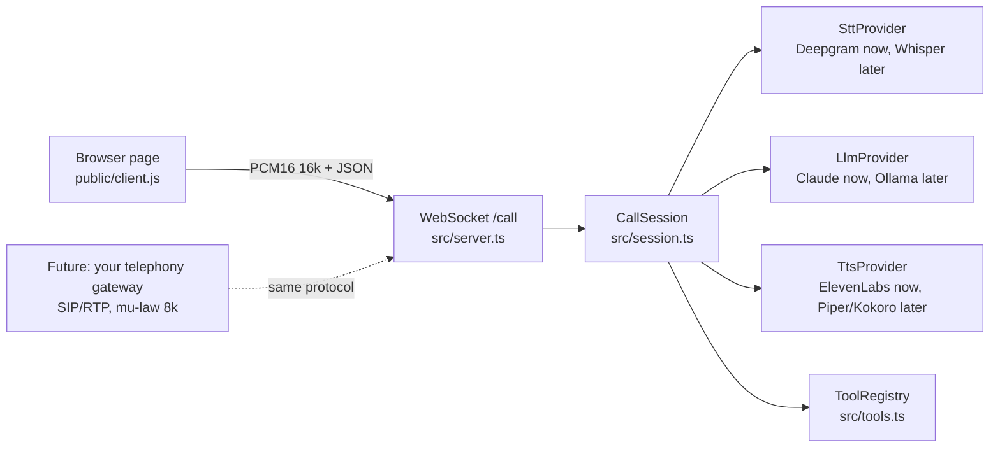

# Design: your own self-hosted voice agent

Goal: a voice agent stack you own, written from scratch in TypeScript. It starts on hosted APIs (Deepgram, Claude, ElevenLabs) and moves to local models later. Its transport is designed so that your own telephony layer (your "own Twilio") can plug in after this.

The starter is in `../voice-agent/`. It is an original implementation: no Vapi code is copied. Vapi's public docs informed the turn-taking model and the event names (see `ARCHITECTURE.md`). Don't use Vapi's name or branding on your product.

## What to copy from Vapi, and what to skip

**Copied as concepts:**
- a streaming pipeline at every stage
- endpointing by transcript shape
- barge-in rules (`numWords`, acknowledgement and interruption phrases, backoff)
- `turnId`-tagged output, so interrupted text can be discarded
- a sentence chunker in front of TTS, with `<flush/>` support
- raw-PCM WebSocket transport
- one provider interface per model type

**Skipped for now:**
- **Daily.co WebRTC.** WebSocket is simpler and is also what a telephony gateway speaks. WebRTC would only be worth adding later for bad networks.
- **Squads and handoffs**, the dashboard, multi-tenancy, campaigns, evals and billing.

## Architecture (as built)

| Piece | File | Role |
|---|---|---|
| Wire protocol | `src/protocol.ts` | Binary frames carry PCM s16le mono 16 kHz. JSON events: `listening`, `transcript`, `speech-update`, `model-output`, `user-interrupted`, `tool-call`, `status-update`. Client commands: `say`, `add-message`, `end-call`. |
| Turn-taking | `src/turn-taking.ts` | Endpoint delay: 0.1 s after punctuation, 0.5 s after a number, 1.5 s with neither. Interrupt decision: interruption phrases > acknowledgements > word count. |
| Orchestrator | `src/session.ts` | Endpoint timer; one turn at a time, each with its own `AbortController`; in-order TTS queue; playback clock (to know when the assistant is still audible); barge-in; backoff; recording what the user actually heard before an interruption. |
| Chunker | `src/chunker.ts` | Sentence-first splitting, then clauses or spaces past length limits, plus `<flush/>`. |
| Claude | `src/providers/claude.ts` | Streaming tool loop on `claude-opus-5-5` at `effort: "low"` for fast first words. Server-side refusal fallback is on (`fallbacks: "default"`). Strict, eagerly streamed tools; append-only history. |
| Tools | `src/tools.ts` | `end_call` and `get_current_time`, with Zod validation of model-supplied input. |

## Latency budget (target: under 1 s from end of speech to first audio)

| Stage | Typical |
|---|---|
| Endpointing wait | 100 ms (punctuated) to 1.5 s (unpunctuated) |
| Claude first text token | Depends on model and effort; measure it |
| First sentence complete | Plus however long the first sentence takes |
| ElevenLabs Flash first audio | About 75-150 ms (vendor claim) |
| Network | About 50 ms |

**Biggest levers, in order:**
1. **Smarter endpointing.** Deepgram's end-of-turn detection or a turn-detector model, instead of the punctuation heuristic.
2. **Model and effort choice.** The starter uses Claude Opus 5.5 at low effort. For lower latency, try `LLM_MODEL=claude-haiku-5-5` or `claude-sonnet-5-5` and measure.
3. **A shorter first chunk.** Have the prompt open with a short sentence.

## Roadmap

1. **Now (starter):** browser calls, hosted APIs, barge-in, tools.
2. **Local models:** add `src/providers/whisper.ts` (faster-whisper or whisper.cpp server), `ollama.ts` (OpenAI-style streaming), and `piper.ts` or `kokoro.ts`. No session changes are needed; switch with the `STT_PROVIDER`, `LLM_PROVIDER` and `TTS_PROVIDER` variables.
3. **Webhooks:** a `server.url` per assistant. POST `end-of-call-report`, `status-update` and `tool-calls` for tools defined remotely, matching the request/response pattern in `ARCHITECTURE.md` §4.4.
4. **Your telephony layer** (the "own Twilio" project). Build it as a separate gateway that speaks this WebSocket protocol:
   - SIP signalling, plus RTP media relayed to the WebSocket. Transcode mu-law 8 kHz ↔ PCM 16 kHz, or add a `format` option to the protocol.
   - DTMF events
   - call transfer (SIP REFER)
   - recording
   - Reaching real phone numbers (PSTN) still needs a SIP trunk from a carrier (Telnyx, Bandwidth, and others) unless you become a carrier yourself.
5. **Production hardening:** auth on `/call`, per-call logs and metrics (time-to-first-audio per stage), recordings, max concurrent calls, and graceful shutdown.

## Known limitations of the starter

- **Endpointing is a heuristic.** The punctuation rule depends on Deepgram's `smart_format`.
- **What was heard is estimated.** The playback clock is computed on the server, so the record of what the user heard before an interruption is approximate, accurate to within one sentence.
- **No echo handling on the server.** The browser's echo cancellation does the work, so headphones are recommended. A phone gateway will need its own echo cancellation, or speaker-channel filtering.
- **Browser support.** Firefox may refuse a 16 kHz `AudioContext` with a microphone source. Chrome, Edge and Safari work.
