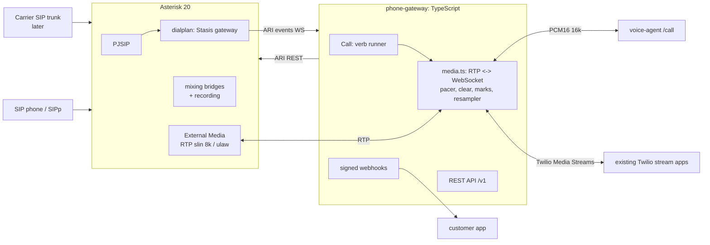
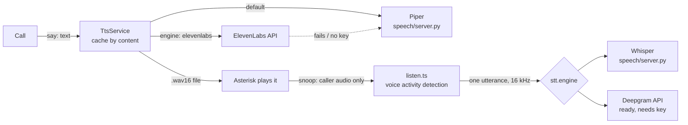

# Design: your own programmable voice gateway ("own Twilio")

**Scope (v1): phone calls only.**
- **Calls:** inbound and outbound, controlled by JSON verbs or TwiML.
- **Voice agent bridge:** a bridge to the voice agent, with barge-in.
- **Call features:** keypad digits (DTMF), dial/transfer, recording, and a REST API.

**Not in v1:** SMS and a carrier connection. SIP works now; phone numbers on the public phone network (PSTN) need a SIP trunk, which you decide on later.

The code is in `../phone-gateway/`. It is an original implementation; the analysis in `twilio-ARCHITECTURE.md` informed the design.

## Architecture (as built)

**Why Asterisk + ARI rather than FreeSWITCH (jambonz's choice):**
- **Installable and testable:** it installs from Ubuntu packages and could be exercised end to end in this container (real SIP via SIPp).
- **ARI is a clean fit:** REST plus a WebSocket of events, so all call logic lives in TypeScript.
- **FreeSWITCH remains an option:** it stays possible behind the same `Call` abstraction if you ever need `mod_audio_fork`-style streaming without RTP passing through Node.

## Key decisions

| Decision | Why |
|---|---|
| **JSON verbs as the core language, TwiML translated into them** (`src/twiml.ts`) | Existing Twilio apps can point at the gateway, but nothing in the design depends on Twilio's XML. Unsupported TwiML (`Say`, speech `Gather`, `Enqueue`…) raises an error rather than silently doing nothing. |
| **Two audio protocols on `connect`** | `native` is the voice agent's PCM16 16 kHz protocol, so no adapter is needed. `twilio` is Media Streams with μ-law, `mark` and `clear`, so existing Twilio stream apps work unchanged. |
| **Gateway paces outbound audio (20 ms frames)** | Apps can send a whole sentence at once, as with Twilio. `clear` and `user-interrupted` drop the queue instantly for barge-in, and marks report when playback has really finished. |
| **8 kHz slin to Asterisk, resampled to 16 kHz in TS** | Asterisk 20's External Media drops slin16 audio sent back to it (dynamic payload type not mapped on receive). This was found and verified in testing. Phone audio is 8 kHz anyway, and the FIR resampler is unit-tested against aliasing. |
| **Signed webhooks** | JSON apps get `X-Gateway-Signature: t=..,v1=HMAC-SHA256` (replay-safe). TwiML apps get a Twilio-compatible `X-Twilio-Signature`, so their usual validator works with the gateway's secret as the auth token. |
| **Action hooks still fire after a hangup** | Like Twilio: a voicemail that ends with the caller hanging up still reports its recording. Fixed a real race found in testing. |

## Verbs (v1)

`answer`, `pause`, `say` (text-to-speech), `play`, `gather` (DTMF and/or speech), `connect` (native or twilio, optional recording), `dial` (SIP URI, number via trunk, or dial string; optional recording), `record`, `hangup`, `reject`, `redirect`.

## Speech (added in v1.1)

- **Text-to-speech is file-based, not streamed:**
  - Each sentence becomes a 16 kHz WAV in the cache, which Asterisk plays.
  - Repeated phrases cost nothing.
  - The first sentence plays while the next is synthesized, so time to first audio is one short sentence (about 150-350 ms with Piper on CPU).
- **Spoken answers are captured from an ARI snoop channel** that hears only the caller. Prompts keep playing on the call, and the prompt's own audio can't trigger the detector.
  - When speech starts, the prompt stops (barge-in).
  - After `speechTimeout` seconds of silence, the answer is transcribed as one piece.
- **Whisper runs in a small local server** (`speech/server.py`) that keeps the models loaded. It also serves Piper.
  - About 1 s per answer on CPU with `base.en`.
  - Deepgram is wired in behind the same interface for when you want lower latency.
- **Tested live:** spoken text is recorded by the test caller and transcribed back word for word. A spoken answer is recognized while the caller interrupts the prompt, silence times out to the next verb, TwiML `<Gather input="speech">` works, and ElevenLabs falls back to Piper.

## Tested live (Asterisk + real RTP)

| Test | What it checks |
|---|---|
| Inbound play | Caller's recording shows the prompt was heard; status callbacks arrive signed and in order. |
| Gather | Keypad digits sent by the far end reach the action hook. |
| Record | Caller audio is captured and served by `GET /v1/recordings/:name.wav` (auth-protected). |
| Dial | Callee is bridged; the bridge recording contains audio; the caller heard the callee. |
| Voice agent bridge | Caller audio reaches the agent. The agent's greeting is heard by the caller as a 440 Hz tone, which also verifies byte order and resampling. Barge-in cuts the greeting short. |
| TwiML + Twilio Media Streams | Event sequence, custom parameters, 20 ms μ-law frames, the mark echoed after real playback, and the caller hears the stream. |
| REST redirect + hangup of a live call | |
| REST outbound call | Status callbacks; a failed call is reported as failed. |
| Real SIP call from SIPp | INVITE answered, BYE accepted, status callbacks. |

## Roadmap

1. **Carrier:** pick a SIP trunk (Telnyx, Bandwidth, …), fill in `[trunk]` in `asterisk/etc/pjsip.conf` (registration/auth or IP auth), and map your numbers in `gateway.json`.
2. **Production hardening:**
   - TLS/SRTP
   - a firewall on 5060 and the RTP range
   - fail2ban-style SIP scanning protection
   - persisting call records (currently in memory)
   - graceful drain on SIGTERM (jambonz lesson)
   - metrics
   - running Asterisk and the gateway as a systemd or containers pair
3. **Features:**
   - conferences (ARI bridges with more than 2 parties)
   - SIP REFER transfers
   - call queues
   - answering-machine detection
   - SMS (needs a carrier with messaging)
4. **Scale:** several Asterisk boxes behind Kamailio as the SBC. A gateway instance owns the calls on its Asterisk, and shared state goes in Redis (the jambonz pattern).
