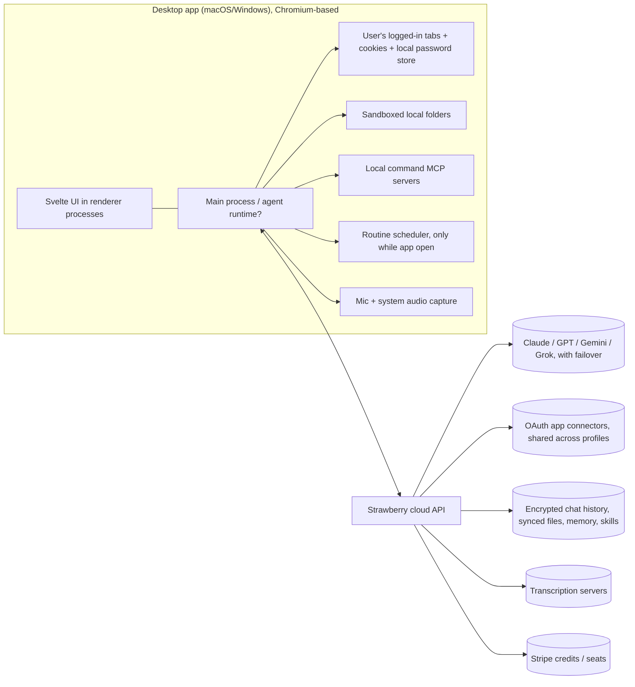

# Strawberry: how it works

**Target:** Strawberry (strawberrybrowser.com), an AI "companion" browser from Strawberry Browser Inc., Stockholm. **Public surface only** (owner-approved scope):

- the marketing site, 35 pages
- the public docs at docs.strawberrybrowser.com. I took the full set in one file via the docs' own `llms-full.txt`.
- 83 of the site's publicly served SvelteKit JS bundles

What I did not do:

- No installer or binary was downloaded.
- No login, form submission or API call was made.
- Nothing was run.

About 126 requests in total, sent about 1 s apart. Provenance (URL, UTC time, HTTP code, sha256) is in `notes/sources.md`.

Every claim is tagged **CONFIRMED** (seen in a page, doc or bundle) or **GUESS** (inferred). Path shorthands:

- `docs:` = `target/strawberry-public/docs/llms-full.txt` (line numbers)
- `site/<page>:` = `work/strawberry-txt/<page>.txt`, a tag-stripped text copy of `target/strawberry-public/site/<page>.html` (line numbers refer to the text copy)
- `js/` = `work/strawberry-bundles/`, prettier-formatted copies of `target/strawberry-public/bundles/`. The minified originals are one line each, so line numbers refer to the formatted copies.

## 1. What it is

Strawberry is a desktop web browser for **macOS and Windows** with built-in AI "companions" (`site/companions:60-61`, `docs:1854`). **CONFIRMED**

- **Companions** are named agents with their own instructions, memory, skills, files and routines (`docs:145-155`). **CONFIRMED**
- **Where they act:** in the user's own logged-in tabs, through OAuth "connected apps" (`site/browser-agent:34,40`), and through local folders and MCP servers. **CONFIRMED**
- **Positioning:** "AI teammates" for non-engineering knowledge work: sales, recruiting, marketing, consulting and ops (`site/strawberry-vs-claude:11-17`). **CONFIRMED**
- **Release:** 1.0 shipped 2026-10-26 (`site/updates_latest:9-11`). Open beta began 2026-02-16 (`:84`). **CONFIRMED**
- **Founders:** Charles Maddock (CEO), Arian Hanifi and Sebastian Thunman (`site/about-us:19-28`). **CONFIRMED**

What Strawberry builds itself, as opposed to what it buys:

- **Built:** the browser shell, the agent harness (plans, sub-agents, work traces, approvals), memory and skills as synced files, routines, and the credit and billing system.
- **Bought:** the models (Claude, GPT, Gemini, Grok; `site/strawberry-vs-claude:23,51`). **CONFIRMED**
- The connector layer is probably bought too, given the claimed "2,000+ connected apps" (`site/strawberry-vs-claude:42`). **GUESS** No aggregator vendor name (Composio, Pipedream and so on) appears anywhere in the public bundles.

## 2. Product surface

### 2.1 Companions and templates

| Item | Detail | Citation | Tag |
|---|---|---|---|
| Official companions (9) | Sales Sally, Talent Theo, Executive Ellis, Marketing Martin, Consulting Cora, Support Sofia, Operations Olivia, Developer Dana, Research Rosa, plus "Create your own" | `site/hire:12-80`; `site/updates_latest:21` ("one of nine") | CONFIRMED |
| What a hired companion is | Arrives "knowing its job, with the skills and routines for it, and spends your first chat learning how you work" | `site/updates_latest:21` | CONFIRMED |
| Companion = folder | Sharing grants access to "that companion's synced folder, including instructions, memories, observations, and companion-specific skills" | `docs:184` | CONFIRMED |
| Hire flow on the web | The "Hire Sally" button POSTs `/api/companion-profiles/official/{id}/hire-intent`, then downloads the app | `js/chunks/a-TuboIE.js:147-158`; `site/index.html` (`href="/download"`) | CONFIRMED |
| Avatar renderer | A `/companion-renderer` route exists on the website; probably rendered inside the desktop app for companion faces | `js/entry/app.B_UfKmki.js:2322` | CONFIRMED route; use is a GUESS |
| Companion Plaza | A "fun mode": companions wander the New Tab page and "chat with each other about... the sites you visited" | `site/updates_latest:22-24` | CONFIRMED |

A companion is a bundle of the following, so the templates are really pre-written prompts, skills and routines plus an onboarding interview (`site/playbooks_automate-sales-pipeline:14`, "Sally starts by interviewing you"). **GUESS**

- a system prompt
- memory files
- skill markdown files
- routine definitions
- an avatar

### 2.2 Features

| Feature | Key facts | Citation | Tag |
|---|---|---|---|
| Chat | Queued follow-ups, steer, stop-and-send, `@` mentions of tabs, apps and chats; visible page context is auto-included | `docs:75-111` | CONFIRMED |
| Agent runs | Search, read pages, navigate tabs, connected-app tools, read/write workspace files, **run code**, ask for feedback, spawn sub-agents | `docs:6-19` | CONFIRMED |
| Sub-agents | Spawned via `strawberry.startAgent()`, each with its own `PLAN.md` | `docs:41`, `docs:1753-1755` | CONFIRMED |
| Plans | `PLAN.md` at the session root; XML `<todo id><title><state>` blocks; the UI re-parses it after each file write | `docs:342-367` | CONFIRMED |
| Skills | Markdown instructions, global (`strawberry://skills`) or per companion; shown in a slash menu | `docs:2345-2420` | CONFIRMED |
| Official Skills | Curated; the "complete technical skill" is in a public GitHub link | `docs:2093-2106` | CONFIRMED |
| Memory | Shared and per-companion; "editable memory files" in Library; a built-in "Memory Best Practices" skill | `docs:2039-2085`, `docs:409` | CONFIRMED |
| Routines | Daily, interval, cron, one-off (date or next event), or app trigger (new email, GitHub PR, webhook); "Only if" filters; each run creates a real chat that it can delete if nothing happened | `docs:2278-2331`; `site/updates_feature-update-2026-10-21:20`; `site/updates_feature-update-2026-10-08:23` | CONFIRMED |
| **Routines need the desktop app open** | "Routines run while Strawberry is open on your computer. Anything that comes due while it is closed waits for you to open it again." | `site/features_routine-automation:37` | CONFIRMED |
| Visual artifacts | Charts and tables in chat; decks, one-pagers, images, short video with sound; export as PNG, PDF or Markdown | `site/features_visual-artifacts:33-42`; `docs:2239`; `site/updates_feature-update-2026-10-21:38` | CONFIRMED |
| Meeting transcription | No bot; captures mic and system audio locally (macOS needs screen and system-audio permission); Meet, Zoom and Teams detection; speaker labels; transcription runs on Strawberry's servers | `docs:2452-2503`, `docs:2794`; `site/updates_feature-update-2026-10-21:28` | CONFIRMED |
| Library and team workspace | Cloud-synced file workspace per account and per team; public `strawberrybrowser.com/files/...` links | `docs:906-928`, `docs:2215-2229` | CONFIRMED |
| Local folders | Companion reads and writes a chosen folder "safely inside a sandbox" | `site/updates_latest:45`; `docs:315-319` | CONFIRMED |
| Browser basics | Import from Chrome-family browsers, Safari, Firefox, Arc and Zen, including passwords and cookies; Chrome Web Store extensions (curated compatibility list); passkeys; PiP; split view | `docs:1218-1267`, `docs:1188-1202`; `site/updates_latest:92` | CONFIRMED |
| WhatsApp | Personal WhatsApp linked via QR code; companion can search and send messages, media and voice notes | `site/updates_feature-update-2026-10-21:23` | CONFIRMED |

### 2.3 Connectors

- **Named in docs:** Gmail, Google Calendar, Drive/Docs/Sheets, Outlook, Slack, Notion, HubSpot, Attio, Salesforce, Ashby (`docs:1583`, `docs:1888-1892`). **CONFIRMED**
- **Named in release notes:**
  - Apollo, QuickBooks, Greenhouse and Klaviyo, part of "over 100 new apps" (`site/updates_latest:36`). **CONFIRMED**
  - WhatsApp (`site/updates_feature-update-2026-10-21:23`). **CONFIRMED**
  - Outlook Calendar (`site/updates_feature-update-2026-10-21:28`). **CONFIRMED**
- **Named in the support blog:** Stripe, Linear, Zendesk, Intercom, Front and Jira (`site/blog_how-we-run-customer-support-at-strawberry:42,58-61`). **CONFIRMED**
- **Claimed count:** "over 2,000 connected apps" (`site/strawberry-vs-claude:42`). **CONFIRMED**
- **Custom tools:**
  - remote HTTP, SSE or Streamable-HTTP MCP servers, with an API key or OAuth
  - local command MCP servers (stdio subprocess, environment variables encrypted at rest)
  - API-key integrations

  Source: `docs:1527-1569`. **CONFIRMED**
- **Per-action permissions:** Ask every time, Always allow, or Disable (`docs:1640-1645`). **CONFIRMED**
- **Brand icon catalog** (`js/chunks/DN6pkpka.js:1-249`): about 245 brand slugs. It mixes integrations with competitor browsers (Comet, Atlas, Dia, Manus, Lindy and others) and backs programmatic `ai-browser-for-<x>` pages (`:361-364`). **CONFIRMED** It is a **marketing icon set, not proof of a working connector**. **GUESS**
  - Present: `shopify` (:116), `woocommerce` (:241), `yelp` (:139), `twilio` (:129), `aircall` (:153), `xero` (:138), `shipstation` (:229), `paypal` (:217), `facebook-pages` (:38), `meta-ads` (:85), `google-search-console` (:198).
  - Absent: Google Business Profile, Square, Toast, Clover, Lightspeed and Trustpilot. **CONFIRMED** absent from the catalog.

## 3. Agent architecture (as far as inferable)

The box layout is a **GUESS**. Each component is cited below.

### 3.1 How companions act

- **Two lanes, chosen by the agent.**
  - **Browser lane:** the companion operates real tabs in the user's own session, so behind-login sites work without APIs (`site/browser-agent:34,40`). **CONFIRMED**
  - **Connector lane:** API tools. The agent "uses a connected app when that is faster than browsing" (`site/browser-agent:34`). **CONFIRMED**
- **Visible, interruptible control.** A floating "AI controller" with "Take over / Stop"; tabs the agent uses glow in its color; you can "take over a previewed page and hand it back" (`site/index:110-111`; `site/updates_feature-update-2026-10-21:37`; `site/updates_feature-update-2026-10-08:17`; `site/updates_latest:86`). **CONFIRMED**
- **The agent may hand you "a website check".** The October 8 release notes list "help with a website check" among requests the companion raises (`site/updates_feature-update-2026-10-08:15`). **CONFIRMED** These are probably captchas or logins the agent asks the human to clear. **GUESS**
- **Code-mode harness.** `strawberry.startAgent()` (`docs:41`) plus "run code" (`docs:6`) suggest the model writes JS or TS against a `strawberry.*` SDK rather than calling only flat JSON tools. **GUESS**
- **Plans and todos are plain files.** `PLAN.md` is "created and updated... with normal file tools" (`docs:342`). **CONFIRMED** This file-centric design extends to memory, skills and companions (`docs:184`, `docs:2058`). **CONFIRMED**
- **Planner plus parallel helpers** since Beta 0.1.0, "generally cheaper on credits" (`site/updates_latest:41-42,70`). **CONFIRMED**

### 3.2 Local versus cloud execution

| Runs locally | Evidence | Tag |
|---|---|---|
| Browser actions in the user's tabs, cookies and passwords | "Passwords, history and cookies are all stored locally... never exposed to us or LLM-providers" (`site/companions:71`) | CONFIRMED |
| Routine scheduling | Only while the app is open (`site/features_routine-automation:37`) | CONFIRMED |
| Command MCP servers, local folder access | `docs:1544-1569`, `docs:315-319` | CONFIRMED |
| Audio capture | Mic and system audio permissions (`docs:2476-2485`) | CONFIRMED |

| Runs in the cloud | Evidence | Tag |
|---|---|---|
| LLM inference | Multi-provider; "smarter default model with automatic failover" (`site/updates_latest:82`) | CONFIRMED |
| Chat history | Encrypted payload plus plaintext titles and metadata on Strawberry servers (`docs:69-71`) | CONFIRMED |
| Files, memory and skills sync | `docs:927`, `docs:2215` | CONFIRMED |
| Transcription | "Cannot reach transcription servers" (`docs:2794`) | CONFIRMED |
| Connector OAuth tokens | Shared "across profiles signed into the same Strawberry account" (`docs:1591`), so they are probably held server-side | GUESS |
| Agent orchestration loop | Whether it runs in the app's main process or on a server is not stated. Routines stopping when the app closes suggests the loop runs on the client. | GUESS |

### 3.3 Permission and approval model

1. A global mode: **Default** or **Ask Always** (`docs:284-291`). **CONFIRMED**
2. Per-integration, per-action settings: Ask every time, Always allow, or Disable (`docs:295-304`). **CONFIRMED**
3. Approval scope: "Ask every time", "Allow in this chat" or "Always allow" (`site/blog_how-we-run-customer-support-at-strawberry:93`). **CONFIRMED** Chat approvals survive closing the tab (`docs:309`). **CONFIRMED**
4. Editable approval cards: you can edit recipients, subject and body of an email before it sends (`docs:311-313`). **CONFIRMED**
5. "Safety countdowns before risky actions" (Beta 0.0.90, `site/updates_latest:78`). **CONFIRMED**
6. Gaps the docs admit:
   - Saved permissions still apply in Ask Always mode, and "app reads without an approval control can proceed without a prompt" (`docs:291`). **CONFIRMED**
   - Agent downloads "may bypass save-location prompts" (`docs:1166`). **CONFIRMED**
   - What gates browser-lane actions (clicking "Submit" on an arbitrary site) is not documented. The marketing copy says it "asks before anything that sends or changes a record" (`site/browser-agent:40`). **CONFIRMED** claim; how it is enforced is unknown.

### 3.4 Memory model

- Memory is file-based and editable: "Companion files / All files" in Library (`docs:2058`). There are two scopes, global and per companion (`docs:2064`). **CONFIRMED**
- Companion folders hold "observations" (`docs:184`), probably auto-extracted notes alongside the curated memory. **CONFIRMED** term; meaning is a GUESS.
- Facts belong in memory and process in skills; a skill does the cleanup (`docs:402-409`). **CONFIRMED**
- No vector store or RAG is mentioned anywhere public. **GUESS:** memory is loaded into context as markdown, possibly with file search.

### 3.5 Model providers

- Claude, GPT, Gemini, Grok "and more" on paid plans (`site/strawberry-vs-claude:23,51`). Free plans get "Curated AI models" (`site/pricing:20`). **CONFIRMED**
- Three modes: **Efficient, Default, Expert**. Free plans get only Efficient and Default (`site/pricing:77`). On paid plans you can choose model and thinking effort per companion per mode, and "Gemini 4 Argon" is listed (`site/updates_feature-update-2026-10-21:14-15`). **CONFIRMED**
- "Use your ChatGPT plan to save credits" is a paid-plan feature (`site/pricing:40`; `js/nodes/139.u1Xjlzq5.js:666`). **CONFIRMED** It probably works by signing in to the user's ChatGPT subscription so OpenAI usage bills there instead of to credits. **GUESS**

## 4. Pricing and credit economics

### 4.1 Plans

| Plan | Price | Credits/month | $/credit | Citation |
|---|---|---|---|---|
| Free | $0 | 500 | n/a | `js/chunks/ChUEv6gF.js:2`; `site/pricing:13-16` |
| Intern | $20/mo, $200/yr | 6,000 | $0.00333 | `js/chunks/BIgjR6wX.js:19-46`; `ChUEv6gF.js:5` |
| Part-Time | $85/mo, $850/yr | 25,000 | $0.0034 | `BIgjR6wX.js:51-78`; `ChUEv6gF.js:6` |
| Full-Time | $250/mo, $2,500/yr | 75,000 | $0.00333 | `BIgjR6wX.js:83-110`; `ChUEv6gF.js:7` |
| Team Starter seat | $35/seat/mo | 10,000 | $0.0035 | `BIgjR6wX.js:115-126`; `ChUEv6gF.js:38` |
| Team Standard seat | $150/seat/mo | 40,000 | $0.00375 | `BIgjR6wX.js:131-142`; `ChUEv6gF.js:39` |
| Team Ultra seat | $350/seat/mo | 100,000 | $0.0035 | `BIgjR6wX.js:147-158`; `ChUEv6gF.js:40` |
| Top-up | $10 per 1,000 ($5 per 500) | Rolls over | $0.01 | `BIgjR6wX.js:179-210`; `site/pricing:54-55` |
| Enterprise | Custom; pooled credits that roll over; invoiced | n/a | n/a | `site/pricing:75-79` |

All rows **CONFIRMED**.

Other price-registry entries:

- **Hidden $0 "work_trial" seat:** `seat.personal.work_trial.month` (`BIgjR6wX.js:3-12`). **CONFIRMED**
- **Team seats:** 3 free per team (`site/pricing:83`). **CONFIRMED**
- **Dormant metered overage price:** `meter_team_usage_monthly_credit` at `unitAmountDecimal: "0.1"` (0.1 cent, so $0.001 per credit), "Team metered overage per credit" (`BIgjR6wX.js:163-176`). **CONFIRMED**
  - The docs say there is "no automatic pay-as-you-go team overage" (`docs:1014`, `docs:1079`). **CONFIRMED**
  - So the meter is unused or legacy. **GUESS**
- **Internal tier names:** the internal keys are `freelance`, `part_time` and `full_time` (`ChUEv6gF.js:3`). Old checkout routes `/get-strawberry/checkout/{pro,business,team,ultra}` survive (`js/entry/app.B_UfKmki.js`, route table from :2236). **CONFIRMED**

### 4.2 Credit cost per action

- **Not documented publicly.** **CONFIRMED** absence. The docs only say:
  - any reply costs credits, and agent runs, research and app actions cost more (`docs:212-214`)
  - "Model input and output tokens are billed as usage cost" (`docs:228`)
  - a credit allowance "is not a guarantee of a particular number of work hours" (`docs:878`)
- **Credits track tokens.** Credits appear to be **token-metered** with model-dependent multipliers. Browsing actions add context tokens, so a page-heavy agent run burns more. **GUESS**
- **Rate-limit windows** sit on top of monthly credits ("Available now"), and top-ups bypass them (`docs:249-260`). **CONFIRMED** This is the classic shape for capping an inference provider's burst cost. **GUESS**
- **"Upfront credit estimation"** has existed since Beta 0.0.70 (`site/updates_latest:98`). **CONFIRMED**

### 4.3 Implied unit economics (GUESS throughout)

- **Subscription credits are discounted.** They cost about $0.0033 to $0.0038 each. A top-up credit costs $0.01, about 3x as much, so subscriptions are a volume discount and top-ups carry the highest margin.
- **If the $0.001/credit meter reflects the cost basis**, then:
  - a fully used Intern plan costs about $6 of inference against $20 of revenue (about 70% gross margin before other costs)
  - Free costs about $0.50 per user per month
  - This rests entirely on the meter being cost-based, which is unverified.
- **Free-tier exposure.** 500 credits is about $1.67 at Intern rates. Credits are spent on inference only (browsing is free), so the free tier's exposure is bounded and mostly paid in LLM tokens.
- **Seats cost more.** Team seats price credits above individual plans ($35 for 10k credits versus $20 for 6k), the usual premium for admin and sharing.

## 5. Trust and security posture

| Item | Detail | Citation | Tag |
|---|---|---|---|
| SOC 2 / GDPR | Wording is "We meet SOC 2 requirements"; it does not say "SOC 2 Type II report" | `site/index:146-147` | CONFIRMED wording |
| Trust Center | trust.strawberrybrowser.com is a **Vanta** trust page; the content loads by GraphQL in JS, so it was not readable statically (no API calls by scope) | `target/strawberry-public/trust/index.html` (Vanta asset and Datadog RUM attributes) | CONFIRMED |
| Security page | "The previous security overview has been retired"; only a vulnerability-report form remains | `site/security:10` | CONFIRMED |
| Legal pages | `/legal/privacy-policy`, `/legal/aup`, `/legal/business-terms` and `/legal/terms-and-conditions` all return a Cloudflare "Just a moment" challenge (403) to non-JS clients | `target/strawberry-public/site/legal_privacy-policy.html`; scratchpad copies of the other three | CONFIRMED |
| Data claims | "No training on your content"; passwords, history and cookies stay local; "We don't sell" data | `site/pricing:49`; `site/companions:71`; `site/index:150-151` | CONFIRMED |
| Chat storage | Encrypted before saving; titles and metadata stored separately, unencrypted | `docs:71` | CONFIRMED |
| Key custody for the chat encryption | Not stated, but chats are searchable and restorable on new devices, so the server can probably decrypt them (not end-to-end) | `docs:69-73` | GUESS |
| Prompt injection | Customer content is to be treated "as evidence, not instructions" (guidance to users) | `site/blog_how-we-run-customer-support-at-strawberry:100-102` | CONFIRMED |
| No connector isolation by profile | Built-in app connections are shared across all profiles; only website logins are separated | `docs:1591-1593` | CONFIRMED |
| Sharing pitfalls | Sharing a companion grants **edit** access; public file links show live updates; issue reports include the chat and a tab screenshot by default | `docs:190-193`, `docs:786`, `docs:1317` | CONFIRMED |
| Local MCP | "Command MCPs run as local processes with your system permissions. Strawberry does not verify third-party MCP servers" | `docs:1566-1569` | CONFIRMED |
| Browser hygiene | Blocks certificates from compromised eMudhra CA keys, pushed without an app update | `site/updates_feature-update-2026-10-21:30` | CONFIRMED |
| Abuse controls (internal) | Admin routes for `device-bans`, `rate-limits`, `flags`, `welcome-bonus`, `vouchers`, `support/memory`, `transcripts`, and `analysis/chat/[chatId]` | `js/entry/app.B_UfKmki.js:2252-2293` | CONFIRMED that the routes exist (not visited) |
| Staff access to user content | An `admin/analysis/chat/[chatId]` route exists, so staff tooling can open individual chats in some form | `js/entry/app.B_UfKmki.js` (admin block) | GUESS |
| Creator program | Asks paid creators to "warm... up" new social accounts "so they look human" | `site/creators:32` | CONFIRMED (reputational note) |

## 6. Tech stack evidence

| Layer | Evidence | Tag |
|---|---|---|
| Desktop shell | The blog describes "separate renderer processes" and a "main process", the Electron vocabulary; it compares itself to Chrome's C++ UI; "massive engine swap" in Beta 0.0.79 | `site/blog_react-to-svelte:33-37,114-117`; `site/updates_latest:88` | Chromium-based is CONFIRMED in substance; **Electron is a GUESS** (consistent with press) |
| Desktop UI | 130k LoC ported from React to Svelte 5 (runes) in two weeks with Cursor, plus Claude Code and Codex | `site/blog_react-to-svelte:13-16,57-73` | CONFIRMED |
| Website | SvelteKit (`x-sveltekit-page`, `/_app/immutable/`), behind Cloudflare (Cloudflare Stream video, Turnstile/challenge) | `target/strawberry-public/_headers/site_index.html.txt`; `site/index.html` | CONFIRMED |
| Docs | Mintlify on Vercel; publishes `llms.txt`, an MCP server card and an agent card | `target/strawberry-public/_headers/docs_llms.txt.txt` | CONFIRMED |
| Auth | **WorkOS** (localStorage key `strawberry.workos.session`); desktop sign-in handoff via `/api/auth/desktop/*` and `/auth/desktop/{login,continue,complete}`; Google sign-in; a Discord auth route | `js/chunks/BC_QQvon.js:130-131`; `js/chunks/ByBm6LfN.js:140`; route table; `docs:1703` | CONFIRMED |
| Billing | Stripe (a price registry with lookup keys, the customer portal, metered price types) | `js/chunks/BIgjR6wX.js`; `docs:850-864` | CONFIRMED |
| Analytics and ads | GTM `GTM-MKVJ43JJ`, Google Consent Mode v2 (`ad_storage`, `ad_user_data`...), Meta `fbq`, LinkedIn; download attribution POSTs UTM params plus `fbclid` and `gclid` | `site/index.html`; `js/chunks/CDMr1JvN.js:7-25`; `js/chunks/a-TuboIE.js:56-70` | CONFIRMED |
| Growth | Referral credits, affiliates, creators paid per view ($2 per 1k), partner agencies | `js/chunks/Cc8VG07i.js`; `site/creators:35`; `site/partner:19-34` | CONFIRMED |
| Website API surface (not called) | `/api/legal/*`, `/api/referrals/*`, `/api/promotion-codes/pending`, `/api/attribution/*`, `/api/download/version-info`, `/api/affiliate/attribute` | grep `/api/` in `js/chunks/` | CONFIRMED |
| Internal eval infrastructure | Admin benchmark runs, batches, packages, per-commit (`commits/[sha]`) results | `js/entry/app.B_UfKmki.js` admin block | CONFIRMED that the routes exist |

No secrets or private API keys were found in the bundles read. The only token-like value is a public GTM ID.

## 7. Weaknesses and gaps (local SMBs and small e-commerce)

1. **Routines stop when the laptop closes** (`site/features_routine-automation:37`). **CONFIRMED** Several SMB jobs need to run 24/7: review replies at night, missed-call follow-ups, order-exception alerts and morning reports before the owner opens a laptop. A browser cannot cover those.
2. **No SMB system of record in the documented connectors.** Shopify, Google Business Profile, POS (Square, Toast, Clover, Lightspeed), review sites and phone/SMS appear in **no** doc, feature page or release note. **CONFIRMED** absence.
   - Shopify, WooCommerce, Yelp and Twilio appear only as icons in a marketing catalog (§2.3). **CONFIRMED**
   - Google Business Profile and POS brands are missing even there. **CONFIRMED**
   - They may exist among the claimed "2,000 apps". **GUESS** Even so, nothing ships SMB workflows (skills or companions) on top of them.
3. **The ICP is B2B knowledge work.** All 9 companions are sales, recruiting, executive, marketing, consulting, support, ops, developer or research roles (`site/hire:12-74`). All 12 benchmarks are research, LinkedIn or CRM tasks (`site/benchmarks_spec:29-68`). **CONFIRMED** There is no "Store Owner", "Front Desk" or "Reviews" companion.
4. **No phone or voice channel.** No calls, voicemail, SMS or IVR anywhere. The voice features are dictation and meeting capture (`docs:2437-2468`). WhatsApp is linked only as a *personal* account via QR (`site/updates_feature-update-2026-10-21:23`). **CONFIRMED** Using personal WhatsApp-Web style linking for business messaging is fragile and may conflict with WhatsApp's terms. **GUESS**
5. **Desktop only, no mobile.** macOS and Windows only (`site/companions:60-61`). The Claude comparison sells Claude's iOS and Android apps as a reason to choose Claude (`site/strawberry-vs-claude:35`). **CONFIRMED** SMB owners mostly run the business from a phone. **GUESS**
6. **Costs are hard to predict.** There is no per-action credit price; costs depend on tokens and model (`docs:228-232`, `docs:878`). **CONFIRMED** Owner-operators will find it hard to forecast what "answer every review" costs. **GUESS**
7. **Weak isolation for agencies managing many clients.** Connectors are shared across profiles (`docs:1591-1593`), so a consultant running 10 shops' accounts gets no per-client tenant boundary. **CONFIRMED**
8. **Browser-lane fragility.** Behind-login automation depends on the user's session cookies, plus captcha and 2FA handoffs ("help with a website check", `site/updates_feature-update-2026-10-08:15`). **CONFIRMED**
9. **The strength to concede.** The browser lane *can* operate portals without an API, which SMBs have plenty of: supplier portals, marketplace seller centrals, review-site owner dashboards. Strawberry pitches this explicitly to partners ("Every portal without an API becomes billable scope", `site/partner:23`). **CONFIRMED**

## 8. Replicating it as a cloud (server-side) agent

### Easy, or easier in the cloud

- **Always-on routines.** Cron, interval, one-off and webhook triggers with "Only if" filters, plus run history. A server scheduler beats "only while the app is open" (gap 1). **GUESS** (design judgment)
- **API connectors.** OAuth to Gmail, Calendar, Sheets, Slack, HubSpot, QuickBooks, Shopify Admin, Google Business Profile, Square and Twilio, with per-action Ask / Allow / Disable permissions, editable approval cards and "allow in this chat" scope. All are standard patterns (`docs:295-313`).
- **The harness:** `PLAN.md` todos, sub-agents, work traces, file-based memory and skills, and companions as synced folders. All are portable to a server sandbox (§3.1, §3.4).
- **Multi-model routing:** Efficient, Default and Expert tiers with failover; metering by token-based credits through Stripe meters (the same price-registry shape as `js/chunks/BIgjR6wX.js`).
- **Artifacts:** charts, decks and reports with public share links.
- **Mobile and web clients** come for free once state lives server-side.
- **Per-tenant isolation** for agencies (fixes gap 7).
- **Phone/SMS and reviews** via Twilio, the GBP API and review APIs. That is greenfield relative to Strawberry.

### Hard in the cloud

- **Acting inside the user's existing logged-in sessions.** Strawberry's core advantage is that cookies, passwords and passkeys stay local (`site/companions:71`). A cloud agent must either:
  - hold the credentials or session cookies (raising custody, liability and ToS problems), or
  - run a hosted browser (Browserbase-style), which hits 2FA, captchas, device fingerprinting and bot detection (LinkedIn especially)

  Expect a human-in-the-loop "take over" flow over streamed video. **GUESS**
- **Botless meeting capture.** It relies on local mic and system-audio capture (`docs:2476-2485`). The cloud options are a meeting bot (the thing Strawberry markets against) or post-hoc upload.
- **Local folders, command MCPs, Chrome extensions and the import of passwords and cookies.** These are inherently client-side (`docs:1218-1267`, `docs:1544-1569`).
- **"Watch it work in my tab" trust UX.** Glowing tabs and take-over need a client, or at least a live-view stream.

### Net for an SMB cloud product

Most SMB systems of record (Shopify, GBP, Square, QuickBooks, Twilio) have APIs. An API-first cloud agent with 24/7 routines, phone/SMS and mobile approvals covers the SMB core that Strawberry ignores. Add a remote browser **only** as a fallback for API-less portals, with explicit human take-over. **GUESS** (recommendation)
