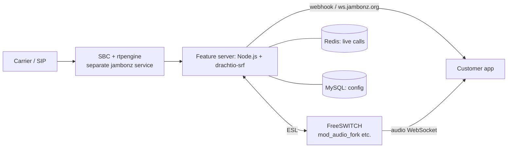

# Twilio Voice and jambonz: how they work

**Targets** (see `notes/sources.md`):

| Repo | What it is | License |
|---|---|---|
| `twilio-oai` | OpenAPI specs | MIT |
| `twilio-node` | Node SDK | MIT |
| `media-streams` | Media Streams samples | **no license** |
| `jambonz-feature-server` | open-source Twilio-like call engine | MIT |

All reading was static. Nothing was run, and no Twilio service was called.

**How claims are tagged:**
- **CONFIRMED** means I saw it in code or the spec.
- **GUESS** means I inferred it.

**Path shorthand:**
- `SPEC` = `twilio-oai/spec/json/twilio_api_v2010.json`
- `VR` = `twilio-node/src/twiml/VoiceResponse.ts`
- `MS` = `media-streams/`
- `JB` = `jambonz-feature-server/`

`media-streams` has no license file, so it was used only to learn the wire protocol. None of its code was reused.

## 1. Twilio Voice: the model

An **app** is a webhook URL. When a call starts, Twilio POSTs call details to it, and the app answers with **TwiML**: an XML list of verbs that Twilio runs in order. **CONFIRMED** (the IncomingPhoneNumber `voice_url` and Call `Url`/`Twiml` fields, SPEC:2470, 13666, 13671)

### Calls
- **Create:** `POST /2010-04-01/Accounts/{AccountSid}/Calls.json` (SPEC:13478). **CONFIRMED**
  - **Required:** `To` and `From`.
  - **App:** `Url`, `Twiml` or `ApplicationSid`.
  - **Callbacks:** `StatusCallback`, plus `StatusCallbackEvent` ∈ `initiated|ringing|answered|completed`, default `completed` (SPEC:13524, 1310).
  - **Call options:** `Timeout` (default 60), `Record`, `MachineDetection`.
- **Statuses:** `queued, ringing, in-progress, completed, busy, failed, no-answer, canceled` (SPEC:1319). **CONFIRMED**
- **Mid-call update:** `POST .../Calls/{Sid}.json` takes `Url`/`Twiml` (redirect) or `Status=completed|canceled` (hang up) (SPEC:14856, 1333). **CONFIRMED**
- **Phone numbers:** each is wired to an app by `VoiceUrl` (+`VoiceMethod`, `VoiceFallbackUrl`, `StatusCallback`). Precedence is TrunkSid > VoiceApplicationSid > VoiceUrl (SPEC:20036, 20085). **CONFIRMED**

### TwiML voice verbs (VR)
- **Say** (:250) speaks text and needs text-to-speech. **CONFIRMED**
- **Play** (:151), **Pause** (:134). **CONFIRMED**
- **Gather** (:110) collects keypad digits or speech. Key attributes: `numDigits`, `finishOnKey`, `timeout`, `action`. Only Say/Play/Pause may nest inside it. **CONFIRMED**
- **Dial** (:57) bridges to another party, given as `Number`, `Sip`, `Client`, `Conference` or `Queue`. Key attributes: `action`, `callerId`, `timeout`, `record`. **CONFIRMED**
- **Record** (:202): `maxLength`, `finishOnKey`, `playBeep`, `action`. **CONFIRMED**
- **Call control:** **Hangup**, **Redirect**, **Reject** (`rejected|busy`). **CONFIRMED**
- **Connect** (:48) hands the call over to `Stream`, `ConversationRelay`, `VirtualAgent` and similar. **CONFIRMED**
- **Start/Stop** (:291, :299) run `Stream`, `Siprec`, `Transcription` or `Recording` in the background. **CONFIRMED**
- **Action hooks:** after a verb with `action`, Twilio POSTs the result (`Digits`, `RecordingUrl`, `DialCallStatus`, …), and the app's reply replaces the rest of the document. **GUESS**: the webhook parameter names don't appear in either repo; they come from general Twilio knowledge.

### Webhook signatures
Every webhook carries `X-Twilio-Signature` = base64(HMAC-SHA1(authToken, fullUrl + concat(sortedKey + value))) (`twilio-node/src/webhooks/webhooks.ts:181-198`). **CONFIRMED**
- The check also tries the URL with and without the default port (:106-114). **CONFIRMED**
- JSON bodies sign the URL with no params, and pass a SHA-256 of the body as a `bodySHA256` query parameter (:205-209, :311). **CONFIRMED**

## 2. Twilio Media Streams (live call audio over WebSocket)

- **Two modes:**
  - **Bidirectional:** `<Connect><Stream url>`. It blocks the call until the socket closes, and the app can send audio back. **CONFIRMED** (`MS/node/connect-basic/templates/streams.xml`)
  - **Listen-only:** `<Start><Stream>`. It forks the audio while the call goes on. **CONFIRMED**
- **Messages, all JSON text frames:**
  - Twilio → app: `connected`, then `start` (with `streamSid`, `callSid`, `customParameters`), then `media` with base64 audio, plus `mark` echoes and `stop`. **CONFIRMED**
  - The exact `start` shape is a **GUESS**.
- **Audio:** μ-law, 8 kHz, mono, 20 ms (160-byte) frames (`MS/java/save-audio/.../WebSocketHandler.java:28-35`). **CONFIRMED**
- **App → Twilio:**
  - `media` with base64 payload. Twilio buffers it and plays it in real time. **CONFIRMED** (samples send in bursts)
  - `mark` is echoed back once the audio queued before it has played. **CONFIRMED**
  - `clear` drops queued audio, which is how barge-in works (`MS/node/dialogflow-integration/server.js:96-106`). **CONFIRMED**

## 3. jambonz (open-source Twilio-like platform)

- **SIP and media:**
  - SIP goes through drachtio-srf (`JB/app.js:17-18`) and media through FreeSWITCH over ESL via drachtio-fsmrf (`JB/lib/utils/install-srf-locals.js:79-133`). **CONFIRMED**
  - rtpengine sits in the separate SBC. **GUESS**
- **Inbound flow** (`JB/lib/middleware.js`). **CONFIRMED**
  1. Initialize, and record an early CANCEL (:120-128).
  2. Look up the account and normalize numbers.
  3. Pick the app by number, regex or SIP realm (:257-320).
  4. POST `session:new` to the app (:452-463).
  5. Turn the reply into Task objects and run them one by one (`JB/lib/session/call-session.js:1353-1463`).
- **Lazy answer:** the media endpoint is created, and 200 OK sent, only when the first media verb needs it (`call-session.js:2489-2591, 2747`). **CONFIRMED**
- **Verbs:** JSON objects with one key each (`JB/lib/tasks/make_task.js`): say, play, gather, dial, listen/stream, llm, transcribe, hangup, redirect, sip:refer, and more. **CONFIRMED**
- **App control:** over HTTP or a WebSocket subprotocol `ws.jambonz.org`. That protocol has acks, `redirect` commands that replace the verb list mid-call, and reconnect with `session:reconnect` (`JB/lib/utils/ws-requestor.js`). **CONFIRMED**
- **Audio to an app:** FreeSWITCH `mod_audio_fork` streams L16 straight to the app's WebSocket, so audio never passes through Node. `kill_audio` is the "clear" (`JB/lib/tasks/listen.js:178-311`). **CONFIRMED** for the events; the exact wire format is a **GUESS**.
- **Webhook signature:** `Jambonz-Signature: t=..,v1=HMAC-SHA256` (`JB/lib/utils/base-requestor.js:55-71`). **CONFIRMED**

## 4. Lessons copied into `../phone-gateway`

| Lesson | Where in jambonz | Gateway |
|---|---|---|
| Answer only when a verb needs media; answer from one place | `call-session.js:2489, 2747` | `Call.ensureAnswered` |
| A hangup can land mid-webhook; check again after every await | `middleware.js:120-128` | `Call.fetchApp`, `runAction` |
| A redirect replaces the queue and kills the current verb | `call-session.js:2120-2175` | `Call.redirect` |
| Fire each action/status hook exactly once | `sip_refer.js:129-140` | `Call.statusEvent`, `runAction` |
| A timestamped HMAC on webhooks | `base-requestor.js:55-71` | `src/signing.ts` |
| Drain gracefully on SIGTERM | `app.js:177-211` | **not yet** (see open questions) |

**Bugs seen in jambonz, to avoid.** All **CONFIRMED** by reading the code.
- `ws-requestor.js:75` inverts its own list of message types that skip waiting for an ack.
- `:482-483` reads `this.isBinary` instead of the `isBinary` argument.
- `call-session.js:2490, 2609` creates an `Error` without throwing it.
